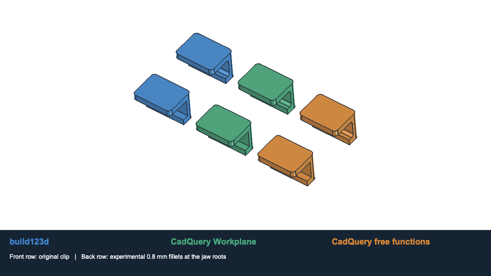

# build123d versus CadQuery for the processor

Compared locally on 2026-10-28: build123d 0.13.0, CadQuery 2.8.0 (both Workplane
and free-function APIs), Python 3.13.14 and FreeCAD 1.1.4 on macOS ARM64.

**Decision:** use build123d as the preferred direction for future model authoring,
consistent with the user's broader STEP/manufacturing work and preferred coding
style. CadQuery is the more mature project and remains a capable alternative.
STEP support, CAD accuracy, Python automation and simulation access are not unique
advantages of build123d. This comparison found no geometry-correctness advantage
for either library on the tested clip.



## What we actually implemented

The existing retaining clip in `v2/guide.scad` is a rounded block with two cuts.
It is a useful real part, but simpler than the earlier description of it as a
particularly demanding test. Each implementation reproduces that part and adds
an optional **experimental** fillet at the two inner jaw roots to exercise edge
selection after Boolean operations.

- [build123d algebra implementation](../simulation/comparison/clip_build123d.py)
- [CadQuery Workplane implementation](../simulation/comparison/clip_cadquery.py)
- [CadQuery free-function implementation](../simulation/comparison/clip_cadquery_func.py)

All use the same dimension fixture, geometric edge-selection rule and input
guards. The production SCAD models are unchanged. The root fillets, dimension
variants and demonstration STEP bore are experiments, not released clip designs.

## Results

| Check | build123d | CadQuery Workplane | CadQuery free functions |
| --- | --- | --- | --- |
| Regular cases produce a valid single solid | 35/35 | 35/35 | 35/35 |
| Original clip agrees with the SCAD reference | Yes | Yes, via native equivalence | Yes, via native equivalence |
| Exported STEP geometry agrees across implementations | Yes | Yes | Yes |
| Experimental 1.6 mm root fillet | Valid | Valid | Valid |
| Experimental 2.6 and 3.2 mm root fillets | Rejected | Rejected | Rejected |
| Six invalid inputs rejected by our shared guard | Yes | Yes | Yes |

The regular cases cover the original, a 27-case width/opening/root-radius grid,
three outer corner radii, two spine thicknesses and two lower-jaw thicknesses.
The grid includes an additional construction of the default dimensions. Invalid
input rejection is evidence for our shared guard, not a library robustness score.

FreeCAD imported every successful STEP and checked single-solid validity and
volume preservation. For the 36 cases successful in all implementations (35
regular plus one exploratory), the measured symmetric difference was **0 mm³**:
subtracting each solid from the other produced no volume. This is a numerical
check with a 0.00001 mm³ acceptance threshold, not a mathematical proof of equality.

The original native clip was compared with the production OpenSCAD STL at 428
vertices/triangle centroids. Maximum sampled boundary deviation was **0.001071 mm**;
relative volume difference was **0.0068%**. The small difference is consistent
with analytic arcs versus polygonal arcs.

For the manufacturing workflow, both libraries imported the same STEP file,
cut a 0.8 mm diameter bore through the spine and exported the result. Both results
were valid single solids and their symmetric difference was **0 mm³**.

Build123d reported its excessive fillets with a `ValueError` explaining the radius
failure and suggesting a smaller radius or `max_fillet()`. Both CadQuery styles
returned `Standard_Failure: BRep_API: command not done`. That is a concrete error
reporting advantage in this test; all three rejected the same two shapes.

## Timing and readability

Warm build medians from nine sequential repetitions, excluding imports, shape
validation and STEP I/O; the shared parameter guard remains inside each build:

| Implementation | Original clip | With 0.8 mm root fillets |
| --- | ---: | ---: |
| build123d | 12.75 ms | 16.55 ms |
| CadQuery Workplane | 55.00 ms | 75.76 ms |
| CadQuery free functions | 23.73 ms | 36.04 ms |

These compare the installed stacks: build123d used OCP **8.0.1.1** while CadQuery
used OCP **7.9.3.1**. Different kernels, wrapper behavior and cleanup operations
confound attribution. This is a small local microbenchmark, not evidence that
build123d is generally faster. All three are fast enough for this clip.

The three model files are 26, 31 and 23 lines respectively after the same formatter,
including imports and blank lines and excluding the shared fixture. The
free-function CadQuery version is shortest here; line count is not a readability
score. All three are reasonably small.

Build123d's algebra API makes geometry and transformations explicit objects,
and uses `Axis`/`Align` enums and shape-list filtering. CadQuery Workplane is compact
for sequences such as selecting a face, creating a workplane and making holes.
Its free-function API also allows explicit geometry without the Workplane stack.
The difference is how we express the design, not whether one can express it.

## Maturity and actual differences

CadQuery's original repository dates to **2013**; the build123d repository dates to
**2022**. Repository age alone is not a quality measure, but CadQuery has the longer
development history. The checked latest stable releases were CadQuery **2.8.0**
(2026-06-20) and build123d **0.13.0** (2026-09-21).
[CadQuery original repository metadata](https://api.github.com/repos/dcowden/cadquery),
[build123d repository metadata](https://api.github.com/repos/gumyr/build123d),
[CadQuery release](https://github.com/CadQuery/cadquery/releases/tag/v2.8.0),
[build123d release](https://github.com/gumyr/build123d/releases/tag/v0.13.0).

| Area | CadQuery | build123d | Consequence for us |
| --- | --- | --- | --- |
| Modeling API | Workplane chains, Sketch, direct shapes and free functions | Builder contexts and algebra, with explicit curve/sketch/part objects | Prefer whichever expresses our reusable parts more clearly |
| Feature selection | Compact selector strings, selector objects and Python filters | Shape lists with enums, filters, sorting and grouping | Both can select geometrically; avoid relying on arbitrary edge indices |
| Assemblies | Constraint definitions and an assembly solver | Hierarchical compounds and explicit joints for relative placement | CadQuery's constraint solving is useful when positions should be solved from mating relationships |
| STEP/manufacturing | Import/edit/export supported | Import/edit/export supported | Both passed our STEP editing test; neither restores lost feature history |
| Underlying geometry | Open Cascade through OCP | Open Cascade through OCP | Related capabilities and failure modes; versions still matter |
| API evolution | Longer history, with ongoing API changes | Younger and actively evolving APIs | Pin versions and run geometry checks before upgrading either |
| Physical simulation | Requires a separate analysis setup/solver | Requires a separate analysis setup/solver | Either can supply geometry to FreeCAD/FEM; neither makes a filling animation into CFD |

An important correction to the initial recommendation: **CadQuery 2.8 made its
free-function API non-experimental**. Direct, unchained modeling is therefore not
a unique build123d advantage. The history-tracking extension is still described as
experimental. [CadQuery 2.8 changes](https://github.com/CadQuery/cadquery/blob/v2.8.0/changes.md),
[free-function documentation](https://cadquery.readthedocs.io/en/stable/free-func.html).

Build123d's 0.12 release removed previously deprecated APIs and changed several
builder/selection behaviors; 0.13 moved its kernel to OCCT 8. CadQuery also removes
deprecated APIs, so maturity does not mean upgrades are risk-free.
[build123d 0.12 changes](https://github.com/gumyr/build123d/releases/tag/v0.12.0),
[CadQuery changes](https://github.com/CadQuery/cadquery/blob/v2.8.0/changes.md).

CadQuery documents solving assembly constraints such as plane, axis and point
relationships. Build123d joints provide relative placement and allowed position/
angle parameters; `connect_to()` performs a one-time reposition, not a persistent
mechanical constraint or dynamics solve.
[CadQuery assemblies](https://cadquery.readthedocs.io/en/latest/assy.html),
[build123d joints](https://build123d.readthedocs.io/en/stable/joints.html).

## Reproduce

Use separate environments: the tested releases require different OCP major
versions. The existing build123d environment can be reused with the pinned
comparison requirements.

```sh
uv venv --python python3.13 .venv-cad  # omit if already present
uv pip install --python .venv-cad/bin/python -r simulation/comparison/requirements-build123d.txt
uv venv --python python3.13 .venv-cq
uv pip install --python .venv-cq/bin/python -r simulation/comparison/requirements-cadquery.txt
python3 scripts/compare_cad_libraries.py
```

The runner executes the backends sequentially, exports their successful cases,
tests STEP editing, renders the production SCAD reference and invokes FreeCADCmd
for equivalence checks. It requires a fresh passing report, since FreeCAD can
exit zero after a Python exception. `--build123d-python`, `--cadquery-python`,
`--freecad`/`FREECAD_CMD`, `OPENSCAD_BIN` and `--output` support other installations.

`build/clip-comparison/` contains per-backend JSON measurements, all successful
STEP files, `comparison.json`, source hashes and `clip-comparison.FCStd` displaying
the original and rounded-root variants side by side. These native comparisons run
locally; hosted CI does not install the CAD libraries or FreeCAD.

Physical clip stiffness, insertion force, fatigue, chemical compatibility and
printed fit were not tested. The source models, STEP exports and numerical tests
are the evidence for this comparison, rather than the visual resemblance alone.
