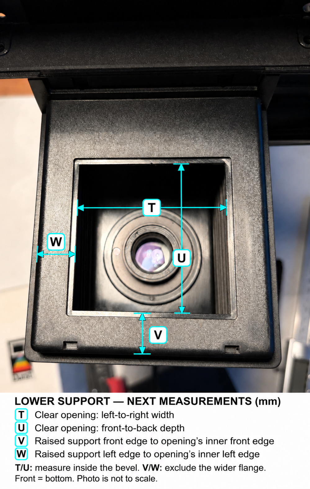
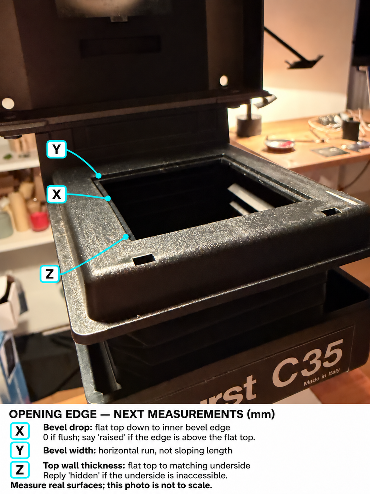

# Durst C35 insertion-area reference

This model replaces the *assumptions* behind the earlier two-ledge sketch with the visible head neck, black underside plate, six screw heads, and the raised lower support with its wider flange. It is a partial reconstruction for future carrier studies, not a dimensionally complete OEM model or a print replacement for the enlarger.

The measured front profile uses **88.55 mm external neck width**, **11.4 mm neck height (L)**, **86.7 mm lower support width (M)**, **11 mm lower support height (clarified Z, replacing N)** and **95.3 mm flange width (O)**. The unloaded vertical gap is **approximately 6 mm**. The closed original carrier is approximately **6.15 mm** high. The user reports that the lower support moves when inserting it. These are separate observations: they do not establish spring stiffness, insertion force, local screw clearances, or the film plane.


## Recorded front measurements: L-O

These labels are new and do not reuse the earlier A-K sheet. The previous **C / assumed support ledges is withdrawn**. B-head means the outside width of the narrow head, not an inside slot width.

| Label | Reading (mm) | Measurement | Exact endpoints |
| --- | --- | --- | --- |
| L | 11.4 | Narrow white band height | From underside of the wider white shoulder to the flat underside of the narrow white band; exclude slot and protruding screws. |
| M | 86.7 | Raised black support width | Outside left to outside right of the raised black section directly below the slot; exclude its wider thin flange. |
| N / clarified Z | 11 (supersedes 10.5) | Raised black support height | Top surface of outer rim down to **top of wider plate/flange**, measured outside and excluding flange thickness. |
| O | 95.3 | Black flange overall width | Its leftmost to rightmost outside edges, immediately above the bellows. |

These readings were supplied on 2026-11-01 and are applied to the model. The original annotation retains its request labels as an endpoint guide. It is an imagegen overlay on IMG_1078; the original photo and actual caliper readings remain authoritative. It must not be used to extract numerical dimensions. The exact built-in imagegen prompt is saved in [annotation-prompt.txt](annotation-prompt.txt).

Next: measure the separate head optical opening and its position, then locate each screw centre and protrusion, any physical insertion stop, and the original carrier's rim spacing/film seat height. Local material thickness beside the lower opening, the outer housing and rear flange extents remain unmeasured. Those later dimensions are not being inferred from photographs.

## Recorded side-view measurements: P-S

IMG_1079 shows the front on the left and the column/rear on the right. The user supplied these readings and explicitly confirmed that **the narrow white head and raised black support end at the same rear plane**. The earlier shallow lower-support model and misleading Q arrow are superseded by this correction.

| Label | Reading (mm) | Measurement / model parameter |
| --- | --- | --- |
| P | 98.3 | Narrow white band's front-to-back depth, excluding the wider housing (`neck_depth`). |
| Q | 98.3 | Raised black support's front-to-back depth, excluding the fixed rear housing (`lower_depth`). Its rear face coincides with P's rear face. |
| R | 2.5 | Thin black flange's thickness, excluding raised support and bellows (`flange_thickness`). |
| S | 4.5 | Flange projection ahead of the raised support's straight front face (`flange_front_overhang`). |

Equal depths plus the explicitly shared rear plane imply a **0 mm front-face offset** (`lower_front_offset = Q - P`). That offset is labelled `derived_from_user`, not a separate caliper reading. The neck and raised support now both span Y=-98.3 to Y=0. A section-based native check verifies these end planes, excluding the wider housing and flange. Q is not an established insertion stop or usable travel.

The cropped outer housing remains an envelope: its former unmeasured 4 mm front/rear overhangs are retained, giving a provisional depth of 106.3 mm. The flange retains its former **unmeasured 9 mm rear extension**; its provisional total depth is now Q + S + 9 = 111.8 mm. Neither total is a user measurement. The shared rear plane applies to the neck and raised support; rear flange extent still needs confirmation.

The [original photo annotation](measurements-P-S.png) and [built-in imagegen prompts](side-annotation-prompts.txt) remain as historical records. Their uncertain Q endpoint does not override the corrected readings or datum relationship above. No new values were inferred from pixels.

## Recorded lower-support measurements: T-W



IMG_1080 shows the lower support from above, with the front at the bottom of the photo. It reveals a broad top surface around a beveled rectangular opening and two small front features. Their height, purpose and actual carrier contact are not established by the photo. The user supplied T-W on 2026-11-01; the annotation above remains an endpoint guide, and no dimensions were inferred from pixels.

| Label | Reading (mm) | Measurement | Exact endpoints |
| --- | --- | --- | --- |
| T | 55.3 | Clear opening width | Left inner straight wall to right inner straight wall, immediately below the bevel. Exclude the larger outer bevel outline and the lens underneath. |
| U | 56.1 | Clear opening front-to-back depth | Front inner wall to rear inner wall, at the same level as T. |
| V | 15.3 | Front offset of clear opening | Outside front plane of the raised black support to the inner front edge used for U. Include the bevel within this distance; exclude the wider projecting flange. Use the straight section between the small front features, not the beginning of the rounded top corner. |
| W | 14.9 | Left offset of clear opening | Outside left plane of the raised black support to the inner left edge used for T. Include the bevel within this distance; exclude the wider flange. |

The actual edges and readings take precedence over the imagegen annotation. Its [prompt set](lower-support-annotation-prompts.txt) records both the built-in edit and the V endpoint correction.

T and U now replace the old 74 x 68 mm centred clearance proxy. Margins to the inner opening are **front 15.3, rear 26.9, left 14.9 and right 16.5 mm**. Its centre is **43.35 mm behind the front plane** and **0.8 mm left of the support centreline**, or 5.8 mm forward of the support's depth midpoint. These are derived from the readings, not new caliper measurements.

The earlier X-axis wording was inconsistent with a right-handed CAD frame. With Y toward the operator and Z upward, **positive X points to operator-left**. Previous geometry was laterally symmetric; no existing asymmetric feature was moved. The measured opening is now located at `X = M/2 - W - T/2 = +0.8`, `Y = lower_front_offset - V - U/2 = -43.35`. The top-view preview puts front at bottom and operator-left at image-left. FreeCAD recovers the actual opening void from an imported section and verifies T/U/V/W independently.

The measured bevel now widens the mouth above the clear rectangle; the straight walls begin 0.8 mm below the top. The hidden shell underneath, front features and contact details remain incomplete. This is the lower support opening, not the separate head's optical aperture; the latter remains provisional and is not automatically recentered.

## Recorded opening-edge measurements: X-Z



IMG_1081 is a useful oblique view from the front-left. These three callouts identify surfaces for caliper measurements; they are not dimensions read from the photograph. The front rectangular features look like openings in this view, but their function and depth remain unassigned.

| Label | Reading (mm) | Definition / use |
| --- | --- | --- |
| X | 0.8 | Vertical drop from the broad flat top down to the inner bevel edge where the straight opening wall starts. Applied to geometry. |
| Y | 1.5 on all four sides | Horizontal run in the top plane. User explicitly confirms the outer opening is 3 mm larger in both dimensions. Applied to geometry. |
| Z | 11 | User clarified this was measured **outside**, from the outer rim's top surface to the top of the whole plate (wider flange). Applied as exterior support height, replacing N=10.5. It is not local top-wall material thickness. |

The upper mouth is therefore **58.3 x 59.1 mm**, concentric with the clear **55.3 x 56.1 mm** opening. Flat top margins to the bevel's outer edge are **front 13.8, rear 25.4, left 13.4 and right 15.0 mm**. A ruled rectangular loft models the measured slope; it is not a 45-degree chamfer. Corner transitions are an idealization. Build123d tests and independent FreeCAD sections verify the outer mouth, intermediate widths, and unchanged clear opening below the bevel.

The clarified Z reading sets `lower_height = 11 mm`. The earlier N=10.5 mm is retained as a superseded observation. With flange R=2.5 mm, the full exterior height is now **13.5 mm**. The top contact plane and approximately 6 mm slot gap stay fixed; the flange moves 0.5 mm downward. The requested local top-wall material thickness remains unknown (`value: null`), and no hidden underside recess is inferred.

Use straight sections away from corners and front notches for these measurements. The corrected annotation uses leaders only because the underside is obscured and the photograph cannot establish the vertical levels. The initial annotation mistakenly drew Z over the whole exterior sidewall; that image is rejected. The [built-in imagegen prompt record](bevel-annotation-prompts.txt) includes the correction. The supplied readings are authoritative; no numeric geometry is extracted from the photo.

## Evidence and editable parameters

[`measurements.json`](../../cad/durst_c35_interface/measurements.json) is the single source for dimensions. Every value has a status, source and (where applicable) photo label. `user_measured` records the supplied reading without claiming caliper accuracy; `user_approximate` preserves the approximate gap. `derived_from_user` records a dimension calculated from explicit readings/observations. Unmeasured values remain `provisional`, and the truncated upper housing height is a `display_extent`.

When a reading arrives, change its `value`, `status` and `source` together, then rebuild. Never turn a visually estimated number into a measured one merely because a CAD check passes. Local photo filenames and hashes are recorded in `photo-evidence.json` so geometry observations are traceable without committing the original high-resolution photos.

The lower interior uses the measured clear rectangular opening, its position, and the bevel's drop and run. Z corrects the exterior support height; hidden shell geometry, local material thickness, contact details and front features remain incomplete. The envelope does not establish uniform carrier contact around all four sides. Screw heads are simple cylinders for collision checks: six are visible, but their diameter, projection and coordinates are unmeasured. The black plate's front tab is represented with its function left unassigned. No rear stop or hidden spring mounting has been invented.

## Datums and lower-support movement

- X: left/right; positive to the left when facing the entry (right-handed with Y/Z below).
- Y: positive toward the operator. Insertion is along negative Y.
- Z: upward. **Z=0 is the flat underside of the head**, excluding screw protrusions.
- Origin: centre of the narrow head's front edge at that underside plane.
- Resting lower contact plane: `Z = -slot_gap`.
- A positive `lower_drop_mm` moves only the lower support downward.

The FreeCAD document exposes `InterfaceParameters.LowerDrop`, with an expression driving the lower support. The other native solids stay fixed. This is an inspectable placement scenario, **not a force simulation or reconstructed bending shape**. The 0.15 mm illustrative placement is only `6.15 - 6.0`; it does not prove the actual deflection or force because contact locations, original compliance and screw clearance remain unknown.

With the **provisional** 0.5 mm screw projection, the local plane separation under a screw is 5.5 mm at rest, even though the flat gap is 6 mm. That example demonstrates why the screws must remain explicit obstacles. It is not a measured 5.5 mm clearance or evidence that a carrier actually passes beneath those heads.

The native file contains imported B-reps and editable lower-support placement. To change dimensions such as L-O, regenerate it from build123d/JSON; changing the informational FreeCAD `HeadWidth` property alone does not rebuild the B-rep.

## Build and verify

```sh
python -m pip install -r cad/requirements.txt
python -m unittest discover -s tests -p test_durst_interface.py
python scripts/check_durst_interface.py --freecad /path/to/freecadcmd
```

Without FreeCAD, `python -m cad.durst_c35_interface.export` exports and checks build123d geometry only. `--measurements path.json` and `--output folder` support another measured revision without editing source code.

Outputs under `build/durst-c35-interface/`:

- `assembly.step` and nine separately named STEP solids.
- `insertion-area.FCStd`, saved/reopened and with lower-support placement checked.
- `measurements.json`, `manifest.json`, `freecad-validation.json` and console log.

The controls test imported solid validity and volume agreement, separation between fixture parts, the measured neck section width, the lower opening's position and bevel sections, clear optical passage through the provisional head aperture, interference above the nominal slot height and local interference at a screw. They also verify the saved lower-support expression after reopening the FreeCAD document. They do **not** test the complete carrier, force, light leakage, repeatability or physical manufacture.

Optional preview, rendered from the verified STEP files:

```sh
python -m pip install 'pyvista==0.49.1'
python -m cad.durst_c35_interface.render
```


## Integration with the carrier studies

This fixture is an independent module on current `main`; the B2 carrier work remains in open PR #15. The old fixture's optical-origin coordinates and 2.6 mm gap must not be silently reused. `legacy_carrier_alignment` is deliberately unset. Once the film-seat height and optical position are measured, place the carrier explicitly in these datums and rerun insertion/contact checks against these solids. The new reference does not inherit the old fixture's passing fit results.

No material, support stiffness, friction or force result is attached to this model. All reports keep `physical_fit_accepted: false` until physical fit is established independently.
