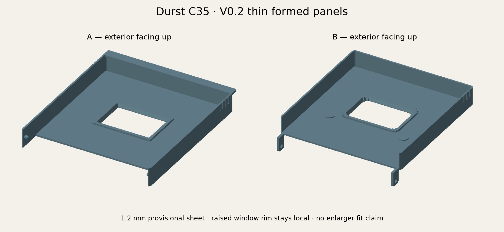
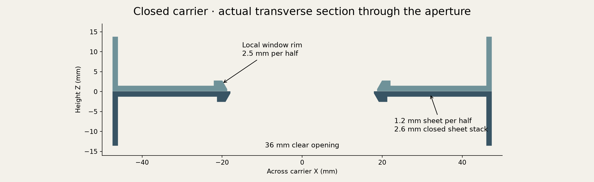

# Durst C35 carrier — V0.2 thin-sheet correction

The failed V0.1 print did not slide into the enlarger. The renewed photo review
establishes **a thin plastic panel with upturned side edges**, with raised details
confined to the perimeter, window and pin seats. V0.2 uses a **1.2 mm sheet** and
separate 1.2 mm side walls. Karl approved 1.2 mm provisionally; it is not a measured
original thickness or a verified slot clearance.



The old CAD already had an exterior cavity, but modeled most of the panel at
2.5 mm, with B reduced to 1.9 mm over a recessed region. Its selected orientation
also generated removable support inside that cavity. We have not inspected the
failed print to distinguish excess model material from retained support. This
revision corrects the sheet construction and explicitly tests the hollow regions.



The ordinary closed sheet stack is **2.6 mm** (1.2 + 0.20 film space + 1.2).
The window rims remain **2.5 mm per half locally**, giving 5.2 mm there. The
upturned edges retain the earlier approximate 13.5 mm height per half; the full
outer envelope is still 27.2 mm. These are different sections of the part, not
interchangeable slot-height measurements. The cavity must remain empty after
support removal.

## Source and dimensions

The editable source is now [build123d Python](../../cad/durst_c35/parts.py), with
[one parameter definition](../../cad/durst_c35/parameters.py). The six SCAD carrier
files have been retired; the V0.1 history remains at commit `9f5d013`. Do not print
the old `durst-c35-v0.1.zip` or scale an old STL to adjust fit.

A is the lower half, with inward hinge pins, film-guide pins and the front lip.
B is the upper half, with hole-bearing hinge ears and blind pin recesses. X runs
along the 36 mm aperture and hinge axis; Y runs from hinge to front. A's film face
is Z=0 and B's is Z=0.20 when closed. The nominal window spans X=-18..18 and
Y=42..66. A's sheet starts at Y=10; B's starts at Y=0. Side edges extend outward
from the film faces, away from the film.

| Feature | V0.2 nominal (mm) | Evidence |
| --- | --- | --- |
| Flat sheet / side wall / A lip thickness | 1.2 / 1.2 / 1.2 | Provisional thin-shell choice; sheet approved 2026-10-31 |
| Width | 94.6 | Earlier user reading: greater than 94, less than 95 |
| A opening | 36 × 24 | Earlier user nominal dimensions |
| B edge relief / corner inset length | 0.8 / 1.8 | Photographed form, estimated detail |
| A / B window-to-rear distance | 32 / 42 | Earlier user ruler readings |
| Window-to-front distance | 34 | Prior estimate |
| Upturned edge height per half | 13.5 | Prior approximate user reading |
| Local window rim total height / width | 2.5 / 2.0 | Prior maximum thickness retained only locally; width estimated |
| Film space | 0.20 total | Prototype choice, set by four stops outside film path |
| Film pin spacing | 58 | Earlier user confirmation |
| Film pin diameter / height | 1.6 / 1.2 | Prior estimates |
| B pin recess depth / remaining floor | 1.3 / 0.6 | Local 1.9 mm bosses prevent a through-hole in the thin sheet |
| A front lip projection | 4 | Prior estimate |
| Hinge ear height / width / thickness | 10 / 7 / 1.8 | First two approximate user readings; thickness estimated |
| Hinge hole centre below film face | 7 | Prior user clarification |
| Hinge pin / hole diameter | 2.4 / 2.9 | Prior prototype clearance |
| Ear-to-side-wall gap | 0.35 per side | Prior prototype clearance |

The raised window profiles keep A's exact land, B's four corner insets and an
outward light-path flare. The hinge architecture is retained. The large stiffening
ribs, recessed front groove and cosmetic label from V0.1 are omitted so the new
thin sheet is not inadvertently thickened or cut through. Bend roots are square
in section; the front plan corners are rounded. These small molding details still
need measurement if exact reproduction is required.

The original [photo index](photo-index.json) and the
[new reference index](photo-index-2026-10-31.json) record private photo hashes.
Photo files stay in ignored local build folders, outside the public repository.
Perspective photos establish construction, not precise thickness or slot dimensions.

## Reproduce the build123d → STEP → FreeCAD study

```sh
uv venv --python python3.13 .venv-cad
uv pip install --python .venv-cad/bin/python -r cad/requirements.txt
.venv-cad/bin/python scripts/check_durst_geometry.py
.venv-cad/bin/python -m unittest discover -s tests -p test_durst_c35.py
```

Install FreeCAD separately. The runner uses `FREECAD_CMD`, then `FreeCADCmd` or
`freecadcmd` on PATH, then the standard macOS app path. You can also pass
`--freecad /path/to/freecadcmd`. Tested locally with build123d 0.13.0 and FreeCAD
1.1.4. The dedicated `durst-cad` CI job installs the official, checksum-pinned Linux
FreeCAD 1.1.4 bundle and runs
the same export and verification commands.

To revise an estimate, pass `--config dimensions.json`, for example
`{"sheet_thickness": 1.0}`, and use a separate `--output` directory. Rebuild both
halves and repeat verification. Other dimension changes may need corresponding
fixture/probe updates; the 90 × 35 × 0.14 mm film is an explicit fixed test fixture.

`build/durst-c35-native/` contains:

| File | Use |
| --- | --- |
| `carrier.FCStd`, `carrier-open.FCStd` | Closed assembly and 110° inspection pose; each saved and reopened during verification |
| `a.step`, `b.step` | Native solids in authoring coordinates; B is unposed at its own Z=0 film face |
| `assembly.step`, `assembly-open.step` | Closed and 110° posed two-part assemblies |
| `plates/a.stl`, `plates/b.stl` | Separate bed-centred print meshes, film faces up |
| `plates/a.step`, `plates/b.step` | Matching native solids in print orientation |
| `parameters.json`, `model-report.json` | Actual dimensions, mesh checks, section values, source/export hashes |
| `validation.json`, `freecad-validation.log` | FreeCAD measurements, hinge samples and execution evidence |

STEP is native solid exchange, not a transfer of Python construction history.
Python remains the editable source. FreeCAD and build123d share Open Cascade;
this is interoperability and contract checking, not two independent CAD kernels.
See the [build123d object documentation](https://build123d.readthedocs.io/en/stable/objects.html)
and [FreeCAD shape API](https://freecad.github.io/SourceDoc/d8/ded/classPart_1_1TopoShape.html).

For interactive rigid hinge inspection, open FreeCAD's Python console and run:

```python
exec(open('/absolute/repository/cad/durst_c35/inspect_freecad.py').read())
start('/absolute/repository/build/durst-c35-native')
```

The slider poses B from 0° to 180°, reports actual intersection volume and turns
B red on overlap. It does not create a constrained assembly or simulate plastic
flexure. The saved `.FCStd` documents work without this optional helper.

Optional static previews use Matplotlib (`uv pip install --python
.venv-cad/bin/python matplotlib==3.11.2`), then:

```sh
.venv-cad/bin/python -m cad.durst_c35.render build/durst-c35-native
```

## Verification and evidence boundaries

Local checks passed on 2026-10-31:

- Both halves are valid single solids; STEP volume errors are below 0.01 mm³.
- Both print meshes are connected, watertight, consistently wound and free of
  duplicate/degenerate triangles; they fit the A1 mini with Z=0 bed contact.
- Sixteen full-height section probes measure the 1.2 mm sheet, plus explicit
  empty-cavity, 1.2 mm wall and 2.5 mm local window-rim checks in FreeCAD.
- Tests deliberately add 2.5 mm and 13.5 mm slabs to otherwise valid solids and
  verify that the thickness checks fail. Watertightness alone would miss these.
- The optical tunnel, A opening, B corner insets/relief, film fixture and 0.6 mm
  blind recess floors pass the FreeCAD probes.
- All **181 rigid hinge positions at 1° intervals** have overlap below 0.0001 mm³.
  Sampling does not establish a continuous swept-volume clearance or ear strain.
- Both `.FCStd` files save and reopen with two valid solids. The runner deletes
  stale reports and requires a newly written success; exit code zero is insufficient.

Physical slot fit, film grip, printed hinge flexibility, light leaks and temperature
performance remain unverified. **No enlarger geometry or insertion simulation is
included yet.** The optional GUI slider is separate from the verified headless study.

## Print handoff

```sh
.venv-cad/bin/python scripts/build_durst_bambu.py \
  build/durst-c35-native build/durst-c35-bambu
```

This creates two individual Bambu projects, reopens and slices each, verifies the
embedded A1 mini / 0.4 mm / PETG profile and original mesh vertices, and requires
warning-free slicing. Print one A and one B. Nothing is sent to a printer.

| Project | Estimated time | PETG including support |
| --- | --- | --- |
| `Durst-C35-v0.2-A-A1mini-PETG-0.4mm.3mf` | 1 h 23 min | 38.60 g |
| `Durst-C35-v0.2-B-A1mini-PETG-0.4mm.3mf` | 1 h 34 min | 41.08 g |

The profile uses 0.20 mm layers, four walls, six top/bottom layers and normal
automatic removable supports. **The print orientation is opposite to the exterior-up
inspection image.** Film-contact faces print upward, so support interfaces are on
the exterior. Support fills some of the apparently hollow space during printing.
Remove it to expose the thin sheet and open cavity shown above. B's downward ears
in the authoring pose explain its 23.5 mm print envelope; that is not sheet thickness.

The mesh's actual part volume is 14.686 cm³ for A and 15.150 cm³ for B. Slicer
material totals include the extra support. Examine the support/model colours in
Bambu's Preview before printing, and check the cleared cavity against `section.png`.

## Next: model the enlarger interface

Keep this carrier coordinate system for the mating model. Before creating a slot
fixture, collect these dimensions/photos from the actual enlarger:

1. Slot cross-section at the entrance and deeper rails: gap height, usable width,
   rail/ledge widths, corner radii and any relief for the raised edges/window rims.
2. Insertion direction, travel to the hard stop, and the surface that sets depth.
3. Window centre relative to that stop and to the side rails; identify which
   surfaces of the original carrier actually slide or locate against the enlarger.
4. Original carrier sheet thickness away from rims, maximum local rim thickness,
   and the first contact marks on the failed print after support removal.

Use orthogonal views with a ruler in the same plane and caliper measurements when
available. The future study should keep the enlarger fixed, translate the closed
carrier along the measured path, report collision/contact surfaces and minimum
clearance, and sweep measured printer/slot tolerances. Do not substitute a guessed
rectangular opening and describe a passing result as reliable slot fit.
