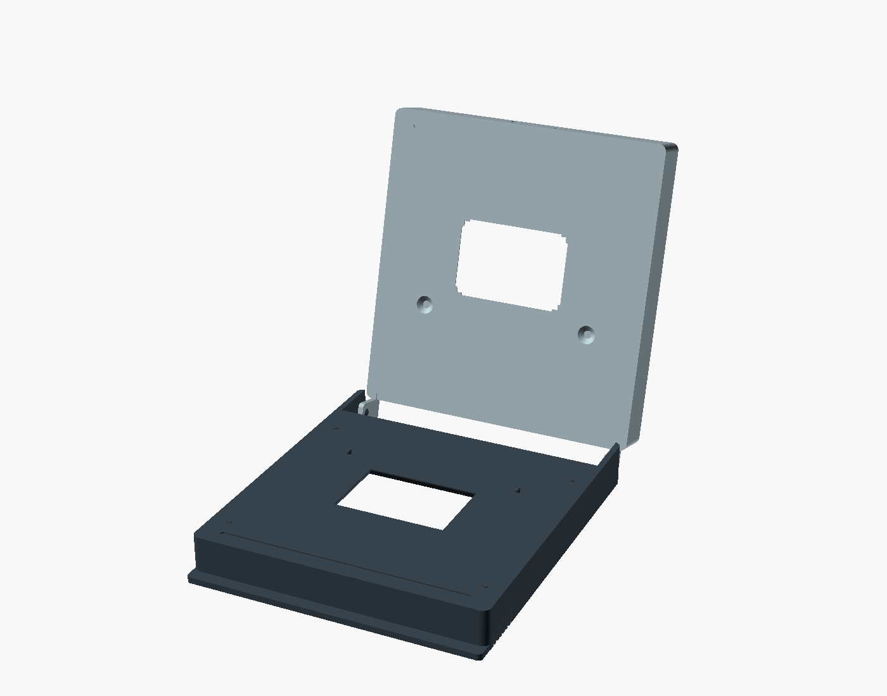

# Durst C35 negative carrier — V0.1 fit prototype

Two individually printed, integral parts reproduce the photographed carrier's basic
construction. **A is lower**: front lip, inward hinge pins and upward film-guide pins.
**B is upper**: front label, flexible hole-bearing hinge ears and blind film-pin
recesses. The hinge end enters the enlarger first. There is no separate axle or mask
insert. The central panels are moulded features in the original.

This first print deliberately uses estimates where calipers were unavailable. The
purpose is to check the actual slot, hinge, film hold and window position, then revise
the dimensions. Digital validation does not establish physical fit, printed ear
flexibility, light exclusion, film safety or temperature suitability in the enlarger.



## Sources and coordinates

- [A print file](../../parts/durst_c35/durst_c35_a.scad)
- [B print file](../../parts/durst_c35/durst_c35_b.scad)
- [Shared editable dimensions](../../parts/durst_c35/parameters.scad)
- [Geometry](../../parts/durst_c35/carrier.scad)
- [Opening preview](../../parts/durst_c35/assembly.scad), with `opening_angle` in degrees

All dimensions are millimetres. X runs along the **36 mm** window dimension and the
hinge axis. Y runs from the hinge towards the front, along the **24 mm** dimension.
B's rear inner-plate edge is Y=0. Its nominal window is X=-18..18, Y=42..66.
A's inner plate starts at Y=10, so the same window is 32 mm from its rear edge.
A's film-contact surface is Z=0; B's is Z=`film_gap` when closed. Both windows share
this coordinate system rather than being centred independently in differently sized plates.

The 13 original photos have been copied, unmodified, into the ignored local folder
`build/durst-c35-reference/`, including a copy in the original checkout. The originals
are not published with this public repository. [The photo index](photo-index.json)
records their names and SHA-256 checksums. Photo 12, B's tilted exterior view, is a
shape reference only: its ruler scale is unreliable because the ears lift the plate.

## Measurements and first-print assumptions

"User" below records the supplied measurement or observation, not a caliper-certified
tolerance. All approximate readings should be remeasured. The nominal aperture and
pin layout are intentionally explicit.

| Feature | V0.1 value | Basis |
| --- | --- | --- |
| A clear aperture | 36 × 24 | User, exact nominal opening |
| Aperture across the carrier | Centred in X | User |
| B clear opening | Nominal 36 × 24 with 0.8 extra at edge midsections | Larger opening and four corner insets observed; enlargement estimated |
| B corner inset length | 1.8 along each nominal edge | Estimated |
| Window rear edge to A plate rear edge | 32 | User ruler measurement |
| Window rear edge to B plate rear edge | 42 | User, measured from nominal window, not B's enlargement |
| Window front edge to common front face | 34 | Estimated from overhead photos |
| Width | 94.6 | User: greater than 94, slightly below 95 |
| Height of each outer skirt | 13.5 | User approximate, excluding B's projecting hinge ears |
| Maximum inner plate thickness, each | 2.5 | User estimate; critical for slot fit |
| Total film space | 0.20 | First-print choice; entire space for film, not extra clearance |
| Assembled outer height | 27.20 | 13.5 + 13.5 + film space |
| Combined inner section | 5.20 maximum | 2.5 + 2.5 + film space; exterior bevels/recess reduce it locally |
| A lip projection / thickness | 4 / 2 | Estimated |
| Outer skirt wall | 2 | Estimated |
| Film-pin spacing | 58 centre-to-centre | User confirmation; 11 beyond each end of the 36 mm window |
| Film-pin diameter / height | 1.6 / 1.2 | Estimated |
| Film-pin centre to long window edge | 6.3 | (35 − 24)/2 + 1.6/2; pin tangent lies on the nominal film edge |
| B film-pin recess | 6 mouth, 2.6 bottom, 1.3 deep | Estimated blind countersink; 0.6 mm material remains behind it |
| B hinge ear height / width / thickness | 10 / 7 / 1.8 | First two are user approximations; thickness estimated |
| B hole centre from ear root / free tip | 7 / 3 | User clarification; root is the film-contact surface |
| A hinge pin diameter | 2.4 | Estimated |
| B hinge hole diameter | 2.9 | First-print clearance; 0.50 diametral difference |
| Ear-to-support side gap | 0.35 per side | First-print clearance |
| Hinge pin protrusion | 2.5 | 0.35 side gap + 1.8 ear + 0.35 engagement beyond ear |
| Outer corner radii / aperture bevels / ribs | See parameters and geometry | Estimated from photos |

The B aperture keeps all of the nominal rectangle open. Material remains immediately
outside its four nominal corners while the middle of each edge is relieved. The A
aperture has a short exact-size land at the film face and widens towards its exterior.
B's exterior window rim is formed by recessing the surrounding panel, so it does not
add height beyond the 2.5 mm maximum inner plate thickness.

Four small stops on A, outside the 35 mm film path, set the chosen film space. They
are a deliberate prototype feature. Changing `film_gap` moves the hinge axis and the
stops together; it does not change either plate's thickness. The printed gap and film
grip must be checked with a real strip. Easy sliding in the original established light
grip, not a measured gap.

## Build and print

Use the repository's existing Python environment and build pipeline. From the repo root:

```sh
python3 -m venv .venv
.venv/bin/python -m pip install -r requirements.txt
.venv/bin/python scripts/check_durst_geometry.py

BAMBU_PROCESS="$PWD/profiles/Durst 0.20mm @BBL A1M.json" \
  .venv/bin/python scripts/build_openscad.py \
  parts/durst_c35/durst_c35_a.scad parts/durst_c35/durst_c35_b.scad
```

The carrier profile inherits **Processor 0.20mm @BBL A1M**: A1 mini, 0.4 mm nozzle,
Generic PETG, textured PEI, four walls, six top/bottom layers, 15% infill. Its only
overrides are support settings. The photographed hollow exteriors and projecting
hinge features require removable supports in the selected orientations; the original
processor profile itself is unchanged.

Print **one A and one B, on separate plates**, retaining the supplied orientations.
Both film-contact faces point upwards. Supports occupy the hollow exterior sides and
hinge overhangs, avoiding support interfaces on the film-contact faces. The B ears
project above its plate in this orientation. Do not print `assembly.scad` as one object.

Each result appears under `build/durst_c35_a/` or `build/durst_c35_b/`. The top-level
`.3mf` is the Bambu project with the profile, suitable for opening and reslicing. The
`generated/` folder contains the STL and sliced G-code. Match the selected filament
preset to the loaded spool before printing. Slicing did not send anything to a printer.

| Plate | Printed bounds, including hinge/features | Slicer time, including preparation | PETG including supports |
| --- | --- | --- | --- |
| A | 94.6 × 110.95 × 14.7 mm | 1 h 46 min | 50.83 g |
| B | 94.6 × 107 × 23.5 mm | 1 h 55 min | 51.18 g |
| Total | Two plates | About 3 h 42 min | 102.01 g |

These estimates are from the V0.1 defaults and resolved profile. Rebuild to obtain new
estimates after edits. B's print height includes its ears; it is not the closed height.

## First fit and next measurements

1. Remove the supports from the exterior cavities, aperture exits and hinge pins.
   Check the film-contact faces and window edges for burrs before trying scrap film.
2. Compare A with the original in the unpowered enlarger. Record where it first binds,
   whether it reaches the normal seated position, and what surface stops inward travel.
3. Engage one hinge pin, then gently flex an ear enough to engage the other. Record
   hole fit, axial play and whether the ears recover. Avoid forcing a tight prototype.
4. Close the two halves without film, then with a spare strip. Check flatness and
   sliding resistance. The goal is a very thin gap and light, even hold at the margins.
5. Check the complete assembly's slot fit and window position against the original.
   Record which half or edge rubs. Physical fit has not been established by the render.
6. With calipers, prioritise the slot-fitting plate thickness, overall width, hinge
   pin/hole diameters, ear thickness, front/window distance, and lip projection. Then
   measure film-pin height/diameter and recesses, and refine B's aperture relief.

Adjust `body_width` or plate thickness for measured slot fit; `hinge_hole_diameter`
and `hinge_side_clearance` for hinge fit; `film_gap` for film space. Do not globally
scale the STL to fix one fit issue: that would also change the known aperture and pin
spacing. Use the editable OpenSCAD parameters and rebuild both parts.

## Validation

Both halves export as one connected, watertight mesh with consistent winding and no
duplicate or degenerate triangles. Bambu slicing reports no warnings. The independent
geometry checks exercise the exact A aperture, four B corner insets and edge relief,
a 90 × 35 × 0.14 mm film probe, bed limits, and 13 closed/open hinge positions from
0° through 180°. These sample rigid geometry; they do not simulate ear strain or
printed surface tolerances. The first physical fit and thermal/light-leak checks remain open.
