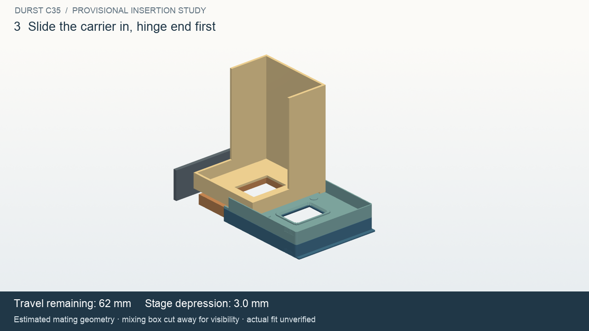

# Provisional C35 enlarger insertion study

This study is authorized without exact measurements. It establishes an editable
interface and checks a prescribed motion against **estimated contact envelopes**.
It does not establish that the printed carrier fits the real enlarger.

[Watch the 16-second insertion and withdrawal video](insertion.mp4).



The [local evidence summary](evidence/2026-10-31/insertion-summary.json) records
181 clear nominal poses, all four detected negative controls and a failed path
for a separately rebuilt 94 mm box. The failure is the expected result for that
control. The MP4 decoded as 384 frames at 1280 × 720 and 24 fps.

## Source evidence

The user's 2026-10-31 photo identifies the enlarger as a Durst C35. The original
[Durst operating manual, archived by J. Ollinger](http://www.jollinger.com/photo/cam-coll/manuals/enlargers/durst/Durst_C35.pdf)
was inspected visually, including its labelled component views:

- Printed page 8 / PDF page 6, section 2.3.2: depress stage 11 and insert carrier 10.
- Printed page 12 / PDF page 10, section 5.3.0: pressing the lower carrier against
  the stage permits front film loading; release closes it. Pins 12 locate the film.

No dimensioned C35 interface drawing or service drawing was found in this search.
The manual's illustrations explain operation, not slot widths or bearing profiles.
The mixing-box illustration on printed page 10 is labelled for the 6×6 accessory;
it is not a dimensional reference for this 35 mm head. The new room photo confirms
the machine but does not expose its hidden contact surfaces. Source hashes and
page references are recorded in [the source index](insertion-sources.json).
The manual and private photo are retained in ignored local `build/durst-reference/`.

## What the provisional model assumes

The carrier retains its own coordinates and geometry. X spans its width, +Y points
from the hinge toward the front grip, and Z=0 is A's film face. Insertion is a
translation along **-Y, hinge end first**, into a fixed head. This direction and
the following shapes are interpretations to verify on the actual machine:

- A mixing-box body between the upturned carrier sides. Two underside contact
  lands meet B's thin sheet; a broad relief leaves room for its window rim and
  pin-seat bosses. These lands and the relief are hypotheses, not traced surfaces.
- A vertically movable U-shaped stage: two narrow rails meet A's thin sheet,
  with an open centre and front. Its width permits the hinge pins and ears to
  pass beside it. The actual stage may have a different bearing profile.
- A separate rear-stop envelope marks an assumed seated depth. The physical
  locating feature still needs to be identified.

The stage moves down first. The closed carrier is held midway in the released gap
and translated inward. It rises to its nominal film plane as the stage returns.
Removal reverses that sequence. The hand-guided carrier movement is prescribed;
the study does not solve gravity, spring force, friction, flexure or film clamping.

All fixture dimensions below are **unmeasured initial hypotheses**, in millimetres:

| Fixture parameter | Initial value | Measurement to replace it |
| --- | ---: | --- |
| Mixing-box lower width | 90 | Width between the carrier's raised sides |
| Mixing-box rear/front Y | 10 / 96 | Underside extent relative to the seated hinge |
| Upper contact plane Z | 1.4 | Actual bearing plane above the film plane |
| Upper contact land width | 7 | Bearing width and profile on each side |
| Underside relief depth | 2 | Clearance above local carrier features |
| Stage outer width / rail width | 84 / 6 | Stage outline and bearing lands |
| Stage rear/front Y | 14 / 96 | Support location and travel obstruction |
| Stage contact plane Z | -1.2 | Lower bearing plane relative to film |
| Stage release travel | 3 | Vertical movement when pressed |
| Rear-stop front Y | -7 | Actual seating stop and optical registration |
| Withdrawn travel | 120 | Required travel to fully clear the head |

The initial 2.6 mm contact-plane separation was **chosen from the candidate
carrier's ordinary sheet stack**. A zero-overlap result is therefore only a
consistency check of this hypothesis. Fixture values are independent constants:
changing carrier thickness does not automatically widen the assumed head to fit.
The mixing-box height, walls and 40×28 optical opening are context estimates too;
the latter does not establish illumination or optical performance.

## Reproduce and change assumptions

Use the native CAD environment and FreeCAD setup in [the carrier guide](README.md).

```sh
.venv-cad/bin/python scripts/check_durst_geometry.py
.venv-cad/bin/python scripts/check_durst_insertion.py
uv pip install --python .venv-cad/bin/python -r cad/requirements-video.txt
.venv-cad/bin/python scripts/render_durst_insertion.py build/durst-c35-insertion
```

The [fixture source](../../cad/durst_c35_insertion/model.py) defines independent
parameters. Pass `--config measured-head.json --output build/durst-measured-study`
to the insertion checker to replace estimates. A configuration such as
`{"mixing_width": 94}` deliberately causes interference with the current carrier;
the checker writes the collision report and exits unsuccessfully. A completed
study and a clear path are distinct report fields.

`build/durst-c35-insertion/` contains fixture STEP solids, byte-for-byte copies of
the verified carrier STEP files, the motion schedule, a hash manifest,
`insertion-validation.json`, and `provisional-insertion.FCStd`. The FreeCAD file
contains five separate valid solids in the seated pose and is saved and reopened
by the verifier. The MP4 is in `video/`.

The animation removes the camera-side upper portion of the mixing box for
visibility. **Collision checks retain the complete fixture.** Each video frame
uses a checked pose rather than an unchecked interpolated placement. It is a VTK
render of STEP solids, not a FreeCAD GUI recording.

## Checks and remaining uncertainty

The study measures pairwise intersection volume and minimum surface distance for
181 poses across stage release, insertion, seating and withdrawal. Nominal contact
at the bearing planes and stop is allowed; volume overlap above 0.0001 mm³ is not.
Discrete samples do not prove continuous swept clearance.

Four negative controls introduce a 2 mm over-insertion, 3 mm lateral error,
unreleased stage on the lowered path, and extra material on ordinary panels to
make them 2.5 mm thick locally. A separate 88–94 mm mixing-box width sweep scales
the complete box in X, including its contact lands, to show sensitivity to an
uncertain footprint. A JSON width override instead rebuilds the box while keeping
the independently specified land width. These checks test the model's
ability to detect interference, not the accuracy of the estimated head.

Next measurements should identify the bearing surfaces first, then their width,
height, relief, stage travel and stop location. Photograph the empty slot from the
front and underside, with the stage both released and pressed. Record which
surfaces of the original carrier touch the enlarger. Finally measure the sheet
and local rims, and locate the optical centre relative to the stop. Those values
can replace the hypotheses without remodeling the carrier or motion workflow.
