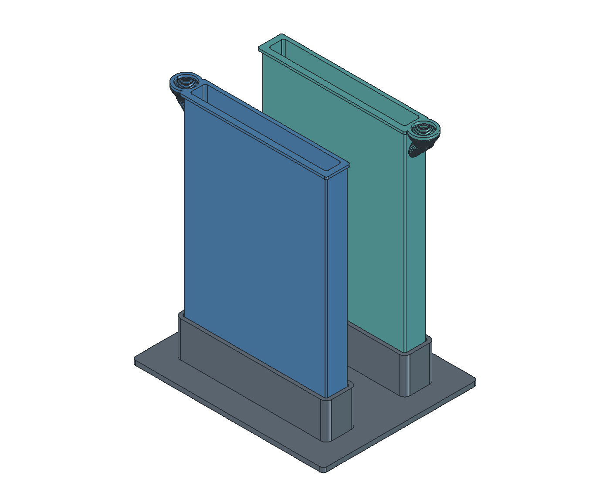

# build123d and FreeCAD: first processor study

The first trial works: Python builds native solids, FreeCAD imports and checks
them without a GUI, and FreeCAD FEM runs Gmsh and CalculiX for a thermal benchmark.
The GUI opens the same saved documents for inspection.



## Recommended direction

Use **build123d for code-based model authoring**, **FreeCAD for visual inspection,
assembly work and FEM**, and STEP to exchange solids. Keep STL/3MF for printing.

OpenSCAD remains effective for compact constructive geometry and parameterized
prints. For this project, build123d's native faces, edges, fillets and solid CAD
exports are a stronger foundation for mechanical development and analysis.
It uses Python and Open Cascade. CadQuery is another credible Python/Open Cascade
choice; this pilot evaluates build123d, not a comparative benchmark of the two.
See the [build123d documentation](https://build123d.readthedocs.io/en/stable/) and
[CadQuery documentation](https://cadquery.readthedocs.io/en/latest/).

FreeCAD is normally used through its GUI, but its document and geometry APIs are
scriptable in Python. This study executes through `freecadcmd`; no GUI interaction
is required to build the study documents or run the checks. A STEP import brings
across solid geometry, not build123d's construction history. The Python source
remains the editable definition. FreeCAD does not automatically turn an imported
assembly into a constrained mechanism or a physical simulation.

This is a migration pilot, not a replacement print release. It includes the shared
v1.8 base and both vessels, with text, tactile marks and fill-cue engraving omitted.
Guides, clips, covers, print supports and heater fittings are not ported. Analytic
curves replace OpenSCAD's polygon approximations. Dimensions still come from the
evaluated OpenSCAD parameter source, avoiding two competing sets of defaults.

A complete switch should port those remaining features, move the parameters and
volume/recipe calculations to Python, and carry over the existing print-envelope,
liquid-volume, paper-clearance and slicer checks before retiring the SCAD sources.
The first physical water-and-paper trial remains necessary with either CAD system.

## Reproduce

Tested locally on macOS with build123d **0.13.0**, Python **3.13**, and FreeCAD
**1.1.4** (revision 20260928), whose application bundle includes Gmsh and CalculiX.
The production OpenSCAD executable must support the Manifold backend.

```sh
brew install --cask freecad
uv venv --python python3.13 .venv-cad
uv pip install --python .venv-cad/bin/python -r simulation/requirements.txt
.venv-cad/bin/python scripts/run_freecad_study.py --thermal
.venv-cad/bin/python scripts/run_freecad_study.py --aspect 2 --output build/freecad-study-wide
```

`OPENSCAD_BIN` overrides OpenSCAD. `--freecad /path/to/FreeCADCmd` or `FREECAD_CMD`
overrides FreeCAD. The macOS application path is the fallback. For installations
with separate solver locations, set `FREECAD_SOLVER_BIN` to a directory containing
`gmsh` and `ccx`. Other platform/package combinations have not been tested.
The thermal script sets FreeCAD's Gmsh executable preference to that location.

The runner evaluates current SCAD parameters, records their source hash, exports
native STEP, renders reference sections, then launches FreeCAD stages. It requires
a newly written passing report: FreeCAD's console can return exit code zero after
a Python exception, so exit status alone is insufficient.

The default output directory is `build/freecad-study/`:

| Output | Purpose |
| --- | --- |
| `processor-fit.FCStd` | Inspect the three assembled solids in FreeCAD |
| `assembly.step`, `base.step`, `vessel_a.step`, `vessel_b.step` | Native solid exchange, with the simplifications above |
| `parameters.json`, `model-report.json` | Evaluated dimensions, source hash, volumes and bounds |
| `fit-report.json`, `freecad-fit.log` | Fit measurements and execution evidence |
| `thermal-report.json`, `freecad-thermal.log` | Thermal cases, assumptions and benchmark comparisons |
| `wall-h*/wall-thermal.FCStd` | FEM setup, mesh and imported temperature results |
| `wall-h*/` solver files | CalculiX input, results and solver logs |

STLs in this study directory are analysis/export intermediates. Use the
[v1.8 production bundle](v1.8.md) for printing.

## Stage 1: fit and movement

Both 16:9 and 2:1 presets passed locally on 2026-10-28.

| Check | Result |
| --- | --- |
| STEP round trip | All three parts remain valid single solids; volume difference below 0.01 mm³ |
| Base size | 170.8 × 138 × 36 mm |
| Bath-to-socket side clearance | 0.600 mm per side for both baths |
| Upright removal | No intersection with base or adjacent bath at lifts of 0, 0.5, 4, 16, 31, 32, 36 and 60 mm |
| Rocking bath A around its front bottom edge | Clear at 0°, 0.5° and 1°; socket collision at 1.5° and 2° |
| Fit-section comparison with current OpenSCAD | Maximum sampled boundary difference below 0.006 mm; section volume error below 0.08% |

The comparison uses a 1 mm horizontal slice at z=20–21 mm, examining mesh vertices
and triangle centroids against native CAD surfaces. It checks the fitting section,
not equivalence of every surface on the complete vessel. Open Cascade powers both
build123d and FreeCAD, so successful exchange is interoperability evidence rather
than an independent geometric-kernel cross-check.

The tolerance sweep treats errors as the **combined outward bath error and inward
socket error per side**:

| Combined error per side | Remaining nominal clearance | Result |
| --- | --- | --- |
| 0.0 mm | 0.6 mm | Clear |
| 0.2 mm | 0.4 mm | Clear |
| 0.4 mm | 0.2 mm | Clear |
| 0.6 mm | 0.0 mm | Contact |
| 0.7 mm | −0.1 mm | Interference |

These are hypothetical dimensional errors, not measured A1 mini accuracy. The
rocking test brackets collision for one pivot/direction; it does not establish a
universal allowed tilt angle. Upright motion is sampled here; the existing SCAD
suite also checks a continuous removal envelope. No friction, deformation,
insertion force or flexible printed clips are simulated.

## Stage 2: thermal solver benchmark

FreeCAD generated a tetrahedral mesh with Gmsh, wrote and ran CalculiX, and imported
the temperature field. The model is a **20 × 20 mm flat wall coupon**, using the
actual 3 mm wall thickness, with:

- A prescribed liquid-side surface temperature of 35°C.
- Air at 22°C and convection coefficients of 3, 5 and 8 W/(m²·K).
- Assumed isotropic PETG conductivity of 0.20 W/(m·K).
- Adiabatic edges and a steady-state heat-transfer solve.

For this deliberately simple case, the expected heat flux is
`q = (35 − 22) / (wall_thickness_m / conductivity + 1 / h)` and the outer surface
temperature is `22 + q / h`.

| Air-side coefficient | CalculiX outer surface | Analytical outer surface |
| --- | --- | --- |
| 3 W/(m²·K) | 34.440°C | 34.4402°C |
| 5 W/(m²·K) | 34.093°C | 34.0930°C |
| 8 W/(m²·K) | 33.607°C | 33.6071°C |

The 5 W/(m²·K) case was repeated with the target mesh size halved from 3 to 1.5 mm.
It increased the mesh from 242 to 757 nodes; the reported outer temperature was
unchanged at the stored 0.001 K precision. All cases agreed with the analytical
answer within 0.001°C. This verifies solver operation and units, not material
accuracy or real bath performance.

This model does not predict cooling time, liquid circulation or heater power.
Those require a full geometry and transient setup with suitable measured material
and boundary data. Radiation, evaporation, infill structure, base contact and the
neighboring bath are absent. No fluid-flow solver is exercised in this pilot.

## Validation coverage

The two native fit studies and four thermal runs were executed locally. The
repository's Python tests also cover rejection of stale or failed FreeCAD reports.
Hosted CI runs those orchestration tests and the existing OpenSCAD/viewer checks;
it does not install or run build123d, FreeCAD, Gmsh or CalculiX.
