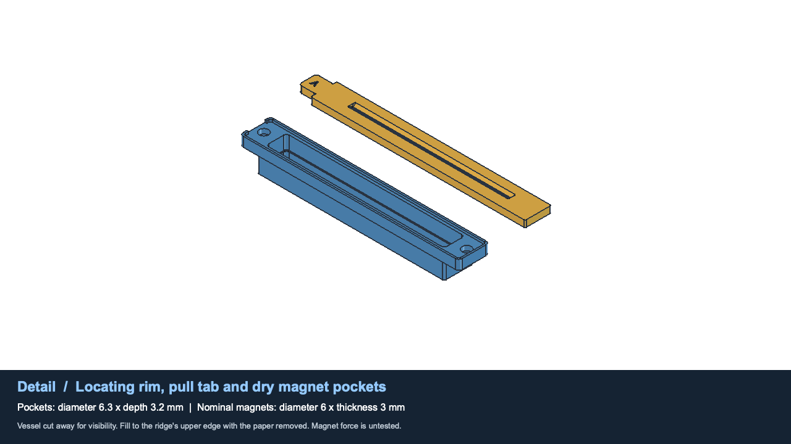

# Native build123d processor

The current **unheated v1.8** has exactly five printed parts: one shared base, two
chambers and two slotted magnetic tops. The Python models in `cad/` are the design
authority. See [v1.8 assembly and printing](v1.8.md) for magnet installation, the
fill ridge, print orientations and use.

`cad/parameters.py` calculates paper dimensions, cavity volume, ridge displacement,
recipe rounding, fill levels and print limits. `cad/parts.py` constructs the solids;
`cad/export.py` exports them. The older OpenSCAD heater design and web viewer remain
available, but do not represent this revision. Full OpenSCAD parity was established
for the previous port in PR #10; it is not an acceptance criterion for this
intentional change to the shape. Current FreeCAD checks test the new interfaces.

## Generate

```sh
uv venv --python python3.13 .venv-cad  # omit when already present
uv pip install --python .venv-cad/bin/python -r cad/requirements.txt
.venv-cad/bin/python -m cad.export --output build/magnetic-16x9
.venv-cad/bin/python -m cad.export --aspect 2 --output build/magnetic-2x1
```

`--config settings.json` accepts overrides from `cad.parameters.DEFAULTS`. Unknown
keys, unsafe pocket dimensions and settings beyond the print envelope fail.
Both presets use the 170.8 × 138 mm base and retain the 208/230 mm paper cuts.
Their new fill volumes are 323/360 ml, including displacement of the inside ridge.

Each output contains five individual part STEP files, `assembly.step`, exactly
five oriented plates in STEP/STL, two liquid-cavity STEP files for validation,
`parameters.json` and `model-report.json`. Cavity geometry is not a printed part.
No covers, clips, trial guides or fit samples are exported. Use a fresh folder
when switching from an older design; obsolete accessory files are rejected.

The finished-part STEP files use local design coordinates. Print **one of each**
`plates/base`, `plates/vessel_a`, `plates/vessel_b`, `plates/guide_a`, and
`plates/guide_b`. Only the vessel print plates contain sacrificial rails.

## Verify in FreeCAD

```sh
.venv-cad/bin/python scripts/check_native.py --output build/magnetic-checked
# Or validate existing exports of a matching preset:
.venv-cad/bin/python scripts/check_native.py --aspect 2 \
  --output build/magnetic-2x1 --skip-export
```

Set `FREECAD_CMD`, or use `--freecad`, for a nonstandard FreeCADCmd path. The macOS
application path is the fallback. OpenSCAD is not required for these native checks.

Checks cover:

- Five single, valid STEP solids with preserved volume after import into FreeCAD.
- Five watertight print meshes, valid STEP plates, bed contact and bounds inside
  the reserved 174 × 174 × 178 mm envelope.
- All ten pairs in the five-part assembly, upright module removal and top lifting.
- Nominal 0.6 mm socket clearance and 0.35 mm clearance inside each locating rim.
- Four paired magnet locations: pocket bore/depth, closed floors, placement outside
  the wet cavity, and 0.4 mm gap between nominal bottomed magnets.
- The continuous fill-ridge boundary, its inward projection and calibrated top edge.
- Empty and paper-loaded liquid volumes within 0.01 ml of the declared fill.
- Eighteen sampled paper positions plus a conservative continuous envelope for
  6 mm vertical and ±3 mm lateral travel through the 1.2 mm slots.

`validation.json` is written only after success; the runner removes any prior report
first because FreeCAD console exceptions can return process exit code zero.
`processor.FCStd` contains the five-part assembly. Rendering saves it again with
colors, visibility and camera set. Headless-only documents may need their objects
toggled visible in the GUI.

The bundled Liberation Sans Bold font makes lettering reproducible. The guide
loft retains 0.001 mm straight segments at capsule-limit corners for stable topology.
The exporter removes zero-area STL triangles before checking watertightness; it
never fills holes or alters the solid to force a pass.

## Video

```sh
python3 scripts/render_native_video.py build/magnetic-checked/16x9
```

The FreeCAD GUI renders the actual STEP solids: five-part assembly, top lifting,
a cutaway detail of rim/pockets/ridge, upright bath removal, filling and paper
agitation. `FREECAD_GUI` or `--freecad` selects the executable. A fresh passing
frame report is required before ffmpeg encoding; ffprobe verifies the frame count
and 1280 × 720 output in `processor-build123d.mp4`.

Filling intersects the actual cavity with a horizontal liquid plane. Paper
movement updates the liquid level for displaced volume. This is **geometric
visualization, not fluid dynamics**; it does not predict pouring, splashing,
mixing or heat transfer. Motion is prescribed, not a magnetic-force simulation.




## Evidence boundaries

Native CI builds both presets and validates solids, meshes, print bounds and
parameter contracts. FreeCAD validation and video rendering run locally. The
existing OpenSCAD CI remains a separate regression check for the older design.

Physical fit, magnet holding force, adhesive behavior, watertightness, paper
friction and chemical compatibility require a printed trial. These digital checks
also share the Open Cascade kernel between build123d and FreeCAD. The revised
ledges/pockets have not yet received a slicer/toolpath or support-removal test.
