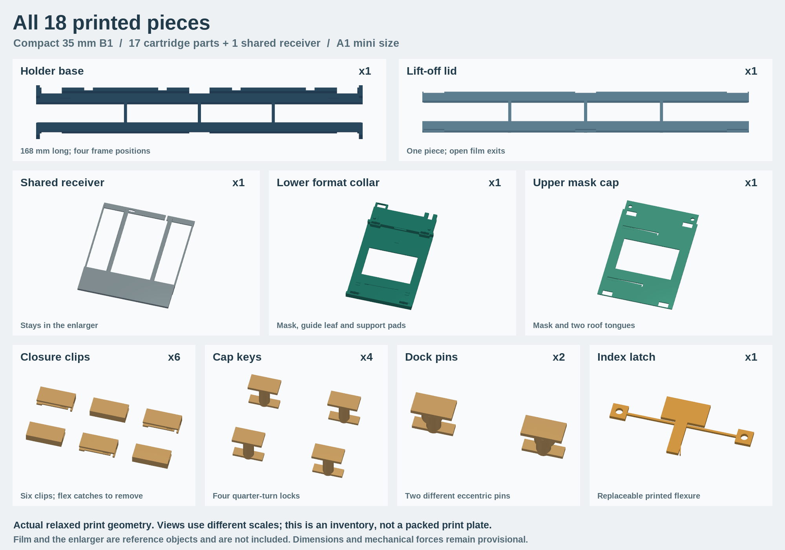

# B1: captive-mask strip cartridges

B1 develops the selected [concept B](../negative-carrier-concepts/README.md) into native build123d parts, a fixed receiver, printed locks and springs, and a FreeCAD-checked operating sequence. The base and lid are **each one piece, with film passages at both ends**. There are no section joints; assume a roughly **300 × 300 mm printer bed** for the default set. A separate compact configuration fits an A1 mini bed.

This is a complete geometric prototype for evaluation, not a measured replacement for the C35. The slot dimensions remain estimates, and APS/110 frame spacing remains illustrative. Actual film grip, spring return, registration error, print tolerances, light leaks and thermal behavior have not been measured. The videos prescribe motion and elastic shapes; they do not solve hand forces or material mechanics.

## Watch the process

The new [parts image](mechanics/all-parts.png) shows all **18 printed pieces** in
the compact four-position 35 mm set, including its shared receiver. Repeated
clips and keys are shown individually. The image uses relaxed print geometry
and independent scales for readability.



The [1080p mechanism close-up movie](mechanics/mechanisms-close-up.mp4) has nine
chapters, also available separately:

| Mechanism | Close-up |
| --- | --- |
| Film margins and lift-off lid | [Place the strip and close the lid](mechanics/01-film-clamp.mp4) |
| Six closure clips | [Flex the tongue, slide home, release the catch](mechanics/02-closure-clip.mp4) |
| Four cap keys | [Quarter-turn crossbars retain the cap](mechanics/03-cap-lock.mp4) |
| Two locating dock pins | [Seat the collar, lower and turn the pins](mechanics/04-docking-lock.mp4) |
| Frame registration | [Release, advance, register, and return](mechanics/05-index-latch.mp4) |
| Guides and vertical support | [Guide leaf, hard pads, roof tongue and support section](mechanics/06-guides.mp4) |
| Open film exits | [First-frame position and outer retaining ears](mechanics/07-end-retention.mp4) |
| Format masking | [Film moves behind the stationary masks](mechanics/08-fixed-mask.mp4) |
| Longer-strip reloading | [Lift and reposition the film at the workbench](mechanics/09-strip-reposition.mp4) |

These close-ups use the compact set's checked STEP assets and subsets of its
existing motion phases; the registration chapter also reverses the same path.
Transparency, hidden covers and the guide section are display treatments only.
The guides are shown in their prescribed seated shapes, not as a solved spring
response. The end-retention view stops at the first indexed position, before
the deliberate overtravel interference tested by FreeCAD. The remaining process
movies below use the larger default cartridges:

- [Load the film, close the lid and assemble its captive collar](videos/135-load.mp4).
- [Install the receiver, then insert and locate a cartridge](videos/135-dock.mp4).
- [Advance through six 35 mm frames, then return to frame 1](videos/135-advance.mp4).
- [Advance a 110 strip through its smaller stationary mask](videos/110-advance.mp4).
- [Release and reposition a longer strip at the workbench](videos/135-reposition.mp4).

The movies use the exported native solids and the same paths as the verifier. Brown numbered rectangles represent the initially indexed image areas; unnumbered rectangles on the tails are additional images. Two extra images at each end illustrate a longer strip, not an entire coiled roll. The enlarger is shown as a translucent cutaway; the close-up makes the index cover transparent. These display treatments do not remove geometry from the collision tests.

## What holds what

The lower frame and lift-off lid capture the film along its margins and across the nominal gaps between images. Six C clips hold the two frames together. Their relaxed printed jaw gap is 1.0 mm; the seated gap is 1.1 mm. That prescribed 0.1 mm jaw spreading supplies the intended clamping preload rather than relying on exact zero-force contact. Each clip also has a long underside tongue with a catch that enters a recess in the base. The tongue is flexed for assembly; it is not a short, rigid interference peg. Film is aligned visually with the frame lands during daylight loading. There are no sprocket-registration pins, and the model does not prove frictional film retention.

The format collar surrounds the closed holder. Its lower mask, upper mask, guide pads and index latch remain stationary during printing. Four printed quarter-turn keys retain its cap. Retaining ears outside the film path prevent the closed collar sliding off either end; the first and last image remain accessible. To load a fresh strip, open the collar and separate it from the holder before removing the clips and lid. That extra daylight assembly is a deliberate B1 simplicity tradeoff.

### Longer strips and uncut developed rolls

Both ends have a film-width passage with 0.4 mm lateral allowance on each side. The former solid end lands are also opened across the image width: the extra images on a longer strip are not clamped against a solid crossbar. The margin supports continue to the exits, with 1 mm long, 0.3 mm deep planar lead-outs. The original margin clamps, interframe lands, six closure clips, guide groove and index rail remain. The closed ends were collar-retention features, not film-length registration stops.

A longer strip can therefore extend from both ends while a selected group of images is clamped. That permits an **uncut developed roll in principle**, with its unused lengths supported outside the holder. The design does not include spool holders, take-up reels or a continuous-feed mechanism. The checks model straight, flat film; they do not establish safe bend radii, curl handling, resistance to tail drag or scratch-free use. Keep the unused film supported independently so its weight does not pull on the clamped section.

To reach another group, withdraw the cartridge and take it to the workbench. Open the collar, release the six clips and lift the lid. Lift the film off the clamping lands, reposition it and align its image gaps, then close and redock the cartridge. The verified sequence shifts **one pitch** to demonstrate bringing an external image into the indexed group. Larger shifts use the same open-clamp loading procedure but are not a modeled roll-feed cycle. Never pull film through the closed clamp. Within a clamped group, the existing indexing provides the intended repeatable position; after releasing the film, the previous photographic registration is **not** preserved automatically.

The receiver remains in the enlarger. The cartridge slides into it from the front, with the two docking pins raised. Lower and turn those pins after seating. Their eccentric shoulders locate the collar against a rear stop and two left-side pads; their crossbars retain it vertically. The left and right dock pins are different, and the right pin starts 90 degrees around from the left. Cam seating is modeled at nominal contact. Real tightening torque, preload, resistance to accidental turning and wear remain prototype tests.

Two hard pads run in a continuous channel under the holder. A printed guide leaf takes up the other wall of this channel, setting the transverse position and resisting yaw. Three lower supports define the vertical plane; two roof tongues press the lid onto them and keep the guide channel engaged. The index tooth enters a pocket for each image. Its hard face locates X, and a small opposing leaf biases the pocket against that face. Pull the paddle back, slide the holder, then release it at the next pocket. The latch's anchor eyes are captured between the collar's posts and cap; it is a separate replaceable print.

The relaxed print geometry includes the clip-jaw preload and 0.2 mm nominal take-up on the guide leaf, roof tongues and small index leaf. The assembly STEP files show these parts in their nominal seated shape; separate `print-native` STEP files and the STL exports contain the relaxed shapes. The four-millimetre release displacement of the main index flexure, the clip-jaw spreading and the clip-tongue deflection are imposed geometry, **not FEA results**.

## Formats and provisional dimensions

All dimensions are millimetres. The mask opening crops each nominal image by 0.2 mm at each edge. The same receiver accepts every default cartridge; each cartridge carries its own matching pair of masks.

| Cartridge | Film width | Nominal image | Demonstration pitch | Images | One-piece holder length |
| --- | ---: | ---: | ---: | ---: | ---: |
| 35 mm full frame | 35 | 36 × 24 | 38 | 6 | 244 |
| 35 mm half frame | 35 | 18 × 24 | 19 | 12 | 263 |
| APS | 24 | 30.2 × 16.7 | 32, **unverified** | 6 | 214 |
| 110 | 16 | 17 × 13 | 20, **unverified** | 6 | 154 |

The maximum holder width, including its end stops, is 62 mm. Its moving vertical envelope is 2.4 mm, from Z = −1.1 to +1.3. The base and lid are each 1.1 mm nominal, with local lands around a default 0.15 mm film. Half-frame image size is camera-dependent: for example, Pentax 17 uses 17 × 24 rather than the generic 18 × 24 template. Check the strip's actual image width and spacing before printing its holder. The default interframe support is 0.6 mm wide for half frame and 1.6 mm for full-frame 35 mm.

The compact [`a1-mini.json`](../../cad/negative_carrier_b/a1-mini.json) configuration retains the same receiver, collar and clamping scheme:

| Cartridge | Indexed positions | Holder length | Conservative square footprint at 45°, including 5 mm brim |
| --- | ---: | ---: | ---: |
| 35 mm full frame | 4 | 168 | 172.7 |
| 35 mm half frame | 7 | 168 | 172.7 |
| APS | 4 | 150 | 160.0 |
| 110 | 7 | 174 | 176.9 |

These fit within the nominal 180 × 180 mm bed geometrically. The [bed check](evidence/a1-mini-bed-fit.json) checks every printable mesh's measured XY extents, with 5 mm brim allowance, and records the required 0° or 45° rotation. Base and lid are separate prints; this is not a packed or sliced print project. A longer film tail does not add indexed positions. The A1 mini configuration is exported and checked independently with the same extended film and operating sequences.

`Config` accepts `film_thickness`, `frame_pitch`, `frame_count` and `image_width` overrides. `film_tail_frames` controls only the demonstration film length (default 2 extra images at each end; 0 restores a short strip); it never changes the printable holder or index spacing. For example:

```json
{
  "half": {"image_width": 17, "frame_pitch": 19.1, "frame_count": 14}
}
```

The 19.1 value above is an example of a measured override, not a claimed specification. More frames can require a bed larger than 300 mm. B1 uses a constant pitch per holder; irregular image spacing requires a future individually calibrated frame-center implementation. The index pockets and frame lands must both match the loaded strip.

The small-format mask stays at the optical axis while **every** frame advances through it. Covering the next image does not make it unavailable: advancing one pitch moves that image into the opening and moves the previous one behind the mask. Masking checks here use normal rays through a 40 × 28 mm source envelope. They do not establish illumination uniformity, edge vignetting or light-tightness under the real diffuser's angular light distribution.

B1 has no shutter. Switch the enlarger lamp off while advancing frames or exchanging cartridges; the stationary masks define the exposure only after a frame is seated.

## Independent enlarger fixture

`cad/negative_carrier_b/fixture.py` copies the earlier C35 insertion study's dimensions without resizing them to this design. Only the coordinate origin moves: its original optical Y = 54 becomes Y = 0. X is frame advance, +Y points towards the operator, and Z is the optical axis.

The fixture has 90 mm mixing-box width, 84 mm lower-stage width, a 2.6 mm gap between the side contact planes, 2 mm additional upper relief in the center, and a rear stop at Y = −61. The moving holder therefore has only 0.1 mm nominal vertical clearance per side in this *hypothetical* slot. That small allowance must be replaced with measurements and printer calibration before a fit claim. The stationary cap keys remain below the assumed central relief and clear the lower-stage rear crossbar.

The [Durst C35 operating manual](http://www.jollinger.com/photo/cam-coll/manuals/enlargers/durst/Durst_C35.pdf), §2.3.2, describes depressing the lower stage to insert the carrier fully. It supports the installation action, not these dimensions. No dimensioned factory slot drawing was found in the earlier study. The fixture source is independent of the cartridge parameters; changing a holder cannot silently enlarge its slot.

## Verification and its limits

Run `scripts/check_negative_carrier_b.py` to regenerate all evidence. It checks:

- Native build123d validity, one solid per part, watertight STL meshes, and mesh/native volume agreement.
- Independent FreeCAD STEP import, validity, volume and SHA-256 provenance, including the relaxed spring geometry.
- All material pairs at sampled poses for film placement, lid and clip closure, collar closure, receiver installation, cartridge docking, every frame position, return to the first frame, and cartridge removal. Long translations are sampled at intervals no greater than 5 mm; short operations have at least five poses.
- The **continuous full frame-advance stroke** with the latch released, using extrusions of the planar moving solids' faces against the fixed parts. This supplements the sampled checks; it does not turn rotations or flexure deformations into continuous mechanical simulations.
- Both actual mask plates at every image position, including adjacent-frame rejection. A deliberately wrong 35 mm mask must leak into neighboring 110 frames.
- A full-width film probe through both exits; image-area contact probes for every modeled image before and after repositioning; and a continuous sweep of the lifted film during the one-pitch workbench repositioning. Both retaining ears must stop deliberate overtravel. Reintroducing the old solid end bar must block the film probe.
- Deliberately wrong motions: an unreleased index, a sideways holder shift, a locked cap lift, a locked docking shift and an unreleased clip pull. Each must produce a positive interference volume. An overthick cap and a solid slab in the enlarger must also fail.
- Saving and reopening one FCStd assembly per format.

The authoritative local results are in [`evidence/freecad-validation.json`](evidence/freecad-validation.json), with dimensions and source/asset hashes in [`evidence/build-summary.json`](evidence/build-summary.json). The compact set has separate [`a1-mini-freecad-validation.json`](evidence/a1-mini-freecad-validation.json) and [`a1-mini-build-summary.json`](evidence/a1-mini-build-summary.json) evidence. Full sampled transforms and all native outputs are regenerated under `build/negative-carrier-b/` and `build/negative-carrier-b-a1-mini/` and uploaded by the PR's CAD workflow. Video metadata and input hashes are recorded in `videos/render-validation.json`.

A programmed return to the same coordinates is not a measurement of photographic repeatability. No slicing, force solution, fatigue test, thermal test or physical fit test is claimed. Layer orientation, small key strength, spring stiffness, clip access and permanent film marking need a sacrificial prototype. The tiny snap features may need a finer nozzle or dimensional adjustment; a watertight mesh alone does not prove reliable printing.

## Prototype parts and assembly

One cartridge uses a full-length base, a full-length lid, six closure clips, two collar halves, four cap keys, two different dock keys and one index latch: **17 printed pieces**, plus the shared receiver. The printable files are in `build/negative-carrier-b/stl/<format>/` and `stl/common/`; the manifest maps each assembly name to its print file. Each listed clip and cap-key occurrence is required even where shapes are identical. Do not print the film or enlarger fixture. These are geometry exports, not oriented or sliced print projects: orient the collar halves and their spring tongues deliberately and inspect support access before printing.

For the first physical test, print one cartridge and the receiver rather than a collection of holders. Use sacrificial film and check that the strips stay seated, the springs return, clips remain secure, and repeated approaches from both directions give the same projected alignment. Check the closed masks with the enlarger lamp before using photographic paper. Production material, print settings and fit corrections should follow those observations; B1 does not yet include a validated slicer profile.

## Reproduce

```sh
python -m pip install -r cad/requirements.txt
python -m unittest discover -s tests -p 'test_negative_carrier*.py'
FREECAD_CMD=/path/to/freecadcmd python scripts/check_negative_carrier_b.py
# Compact monolithic holders with film exits at both ends:
python scripts/check_negative_carrier_b.py --config cad/negative_carrier_b/a1-mini.json --output build/negative-carrier-b-a1-mini --bed-size 180
# Optional: --formats half --config measured-strips.json
python -m pip install -r cad/requirements-concept-render.txt
python scripts/render_negative_carrier_b.py  # requires ffmpeg and an OpenGL renderer
python scripts/render_negative_carrier_mechanics.py  # compact parts atlas + 9 close-ups
# Quick camera/layout inspection without encoding video:
python scripts/render_negative_carrier_mechanics.py --preview --output build/mechanics-preview
```

The close-up renderer refuses stale CAD source hashes or an unmatched FreeCAD
report, and verifies that the atlas includes every printable occurrence exactly
once. `mechanics/render-validation.json` records the input, renderer and output
hashes, original phase indices, phase ranges, endpoint states and video frame
counts. Each individual video and the chaptered combined movie is decoded in
full after encoding. `mechanics/video-qa.json` records additional motion checks
on decoded image regions; physical fit and forces remain separate prototype work.

For macOS the checker defaults to `/Applications/FreeCAD.app/Contents/Resources/bin/freecadcmd`. The hosted workflow uses the same official FreeCAD 1.1.4 release as the concept checks. Native sources live in `cad/negative_carrier_b/`; the original clone in PR #2 remains separate.
