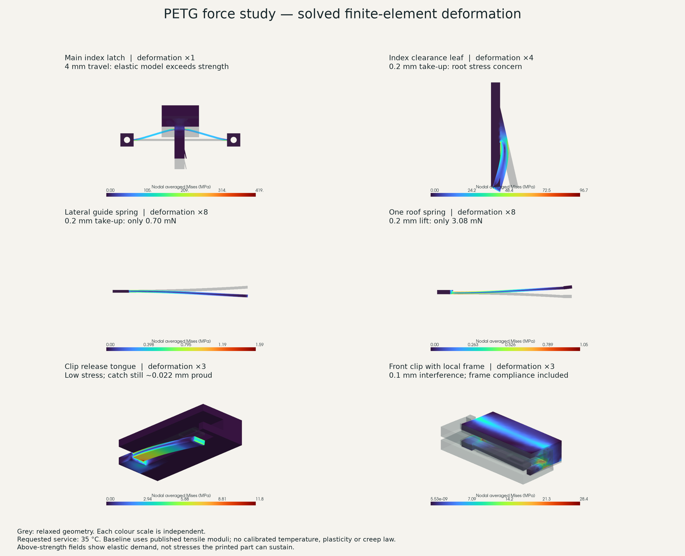
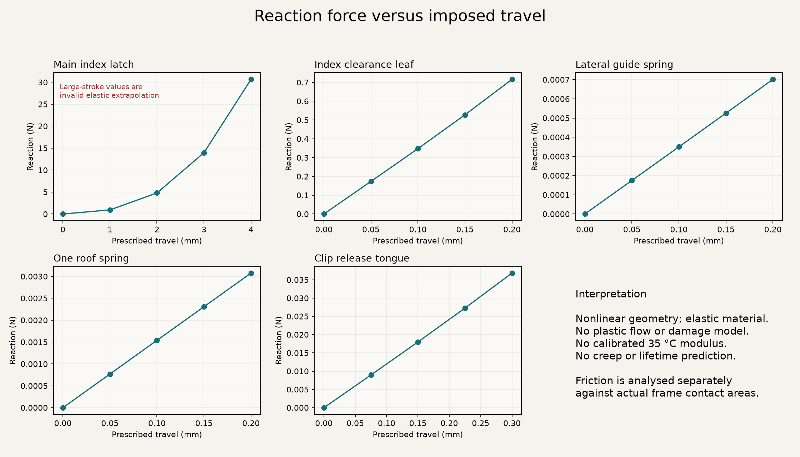
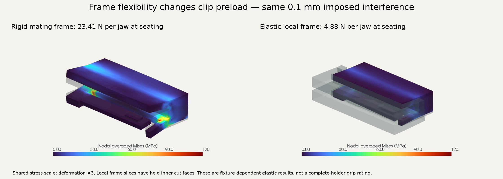

# B1 carrier: PETG force study

**The current prototype does not pass mechanical screening.** The planned 4 mm index-latch stroke produces excessive elastic stress demand. The guide and roof springs provide very little preload. The clip release tongue is much less stressed, but jaw interference and friction need to be considered together with the flexibility of the frame they grip. The motion videos remain useful for geometry; they are not evidence that these mechanisms can sustain their prescribed movements.

The flexure and clip geometries are shared across formats; the mating-frame submodel uses the central clip station of the compact 35 mm holder.

The requested service condition is **about 35 °C at the assembly**. This study uses actual relaxed build123d geometry, quadratic solid elements, geometrically nonlinear CalculiX analysis, and solved frictional contact. It does **not** contain a calibrated 35 °C material law, plasticity, creep, fatigue or a full film/frame contact model. Results beyond the elastic material's useful range are shown as **elastic demand**, not forces or stresses a printed part can actually sustain.



Grey shows the relaxed geometry. Deformation magnification is labelled separately for each panel. Colours are nodally averaged von Mises stress, with separate scales; tabulated peaks below are unaveraged integration-point values. Von Mises stress is a diagnostic scalar here, not a calibrated failure criterion for an anisotropic print.

| Mechanism | Imposed movement | Baseline reaction | Interpretation |
|---|---:|---:|---|
| Main index latch, clamped pads | 4 mm | 30.67 N elastic extrapolation | Unusable prediction beyond strength; redesign required |
| Main latch, pads free to rotate about posts | 2 mm of planned 4 mm | 2.83 N elastic extrapolation | XY tensile demand already about 78 MPa at 2 mm; support rotation does not resolve the concern |
| Small index clearance leaf | 0.2 mm | 0.716 N | About 54 MPa peak XY tension; sharp root needs attention and physical calibration |
| Lateral guide leaf | 0.2 mm | 0.000702 N | Very weak preload; it does not establish bump resistance or repeatability |
| One roof tongue | 0.2 mm | 0.00308 N | Two provide about 0.00615 N total; low preload |
| Clip release tongue | 0.3 mm | 0.0368 N | Low stress, but the high edge remains about 0.022 mm above the nominal release plane |

The release tongue reaches about 11.7 MPa peak Mises, 10.9 MPa XY tension and 4.3 MPa Z tension in its isolated fixture. However, a low stress does not prove successful release: the catch tilts with the tongue, and at 0.3 mm tip travel its highest edge remains at Z ≈ −0.428 mm, above the nominal base clearance plane at −0.450 mm. That is about **0.022 mm interference**, before print tolerances. Simultaneous jaw/frame deformation is not included in that clearance check; more release margin and a coupled/physical check are required.

The 4 mm latch result includes local XY tensile demand around 438 MPa and layer-normal tension around 166 MPa. Those values are far beyond the data used for screening. They should not be read as predictions of actual failure stress or actuation force: yielding, damage, layer separation or a changed deformation path would intervene. Even the 70% stiffness scenario remains above the screening values. Peak stress at the current sharp roots is mesh-sensitive; the converged reaction does not make that peak an allowable design stress.



## Jaw contact and friction

Front and rear clip contacts differ. The front lid ends at Y=23.6 mm and the front base relief ends at Y=23.7 mm; rear frame edges reach 24 mm. The contact footprints are extracted from the actual holder geometry, including the clearance pocket for the positive catch. An oversized rectangular coupon would give a misleadingly stiff result.

The clip starts with its printed 1.0 mm jaw gap. The upper mating part moves 0.1 mm to restore the nominal 1.1 mm seated gap. Subsequent 0.05 and 0.15 mm outward movements solve tangential contact response. The clip is held at two back corners in X/Y, while its spine remains free to bend normally. This is an idealised pull fixture, not a model of a hand gripping the clip.

Two mating assumptions are examined: rigid contact footprints with face-to-face penalty contact, and elastic slices of the actual base/lid with mortar contact. Mortar was used for the deformable mates because a development run with face-to-face penalty contact failed the global reaction-balance check and was rejected. The elastic slices are 12 mm wide and have their inner cut faces held at Y=20 mm. They assess local mating compliance; the complete long frame, film support, six-clip load sharing and film friction are not solved. No value here is a measured retention force for the complete holder.



At the 0.55 mm mesh level, the elastic local-frame models give **4.88 N/front jaw and 5.03 N/rear jaw** at seating. At 0.15 mm withdrawal, the reactions are **2.41 N/front and 2.54 N/rear**, with the assumed friction coefficient 0.3. Seated jaw-region XY tensile peaks are about 23.4 and 18.6 MPa, respectively; Z peaks are about 13.3 and 10.1 MPa. This is a much less severe local stress state than the rigid-frame fixture, but it is not an assembly acceptance result. Refining the front clip and mating frame from 0.55 to 0.40 mm changes the seating reaction by 1.80% (to **4.80 N/jaw**) and withdrawal reaction by 1.60% (to **2.37 N**). The refined jaw-region peak Z tension rises to about 19 MPa, so peak stresses should still not be treated as converged allowables. The 70% stiffness scenario gives 3.42 N/jaw at seating and 1.69 N withdrawal; it is not a calibrated 35 °C prediction.

The positive catch is excluded from the withdrawal contact pairs, deliberately isolating **friction with the catch disengaged**. Catch release is analysed separately. Withdrawal is only 0.15 mm, and some contact points remain in elastic stick: reaction at that displacement is not necessarily a steady sliding force or a pull-out limit.

Friction coefficients 0, 0.3 and 0.6 are assumptions, not measured PETG-on-PETG data. The rigid-frame zero-friction control produces effectively zero tangential reaction. With deformable mates, tilted contact faces can also create a geometric component of tangential reaction, even with zero friction. Pressure-penalty and mesh refinements are included. Concentrated back supports also produce singular local stresses during withdrawal; a separate jaw region (element corner centroids Y < 24.5 mm) excludes those support peaks. Contact-point or slave-node fractions are unweighted, not contact-area fractions. Above-strength contact cases cannot be used to claim useful holding capacity, even when the solver converges.

Detailed contact values and sensitivity comparisons are in [the generated numerical summary](numerical-summary.md). [Machine-readable results](results.json) retain the boundary conditions, pressure/penetration diagnostics, forces, stress metrics and file hashes for every accepted run.

## Material assumptions and the 35 °C case

The source is the current **Bambu PETG Basic V3** [manufacturer technical data sheet](https://store.bblcdn.com/s1/default/cb94589bf7994fdcbfa833badefae9cd/Bambu_PETG_Basic_Technical_Data_Sheet.pdf). The exact formulation of the user's spool is not confirmed. Values are for printed test specimens, including 100% infill and the manufacturer's stated print conditions; they do not represent every sliced wall, seam or print orientation.

| Input | Value | Status |
|---|---:|---|
| In-plane tensile modulus E1=E2 | 2780 ± 65 MPa | Published mean and reported variation |
| Layer-normal tensile modulus E3 | 2550 ± 100 MPa | Published mean and reported variation |
| Poisson ratios ν12, ν13, ν23 | 0.38 | Assumed |
| G12 | E1 / 2(1+ν) | Estimated, not measured orthotropic shear data |
| G13=G23 | √(E1 E3) / 2(1+ν) | Estimated |
| XY / Z tensile strengths | 51 ± 1 / 35 ± 6 MPa | Published means and reported variation; **ultimate strengths, not yield stresses** |
| Softening sensitivity | All E and G ×0.7 | Uncalibrated scenario; **not E(35 °C), and not a guaranteed lower bound** |

Global Z is taken as the print layer normal. Orthotropic tensile moduli are used with the estimated shear and Poisson constants; this is not a full experimentally calibrated anisotropic material model. The sheet also reports lower flexural moduli than tensile moduli, another reason to retain stiffness sensitivity rather than imply excessive precision.

The manufacturer does not provide the temperature-dependent stiffness, yield surface, stress-strain curve, stress relaxation, creep, friction or fatigue data needed to predict long-term force at 35 °C. Glass transition and heat-deflection temperature are not substitutes. The 70% scenario changes reaction forces but cannot establish long-term preload retention. No thermal expansion field is applied because the geometry is treated as the imposed service geometry and a suitable printed material expansion model is not supplied.

## Numerical checks and limits

- Source STEP solids are native build123d B-reps. Gmsh produces ten-node tetrahedra; the node ordering is converted explicitly to CalculiX C3D10. Corner Jacobians are positive and linearised mesh volume must agree with CAD within 1.5%.
- Every accepted solve completes all intended load steps without a CalculiX error. Support and load reactions balance within 0.5% or 0.00001 N. Failed or abandoned pilot runs are excluded from the fixed study matrix.
- A 10 × 1 × 1 mm cantilever displaced 0.01 mm gives 0.006996 N versus the Euler–Bernoulli reference 0.006950 N: about **0.66% difference**.
- Independent mesh levels check reaction-force convergence. The main latch changes about 0.066%, the small index leaf 1.19%, the guide 0.012%, the roof 0.177% and the release tongue 0.716%. Sharp-root stress peaks are not converged allowable stresses. The reported 95th percentiles are unweighted integration-point percentiles, not volume percentiles.
- Exact tip faces or edges impose displacement while permitting rotation. Loading a finite tip volume can artificially stiffen these small springs. Tests guard against that error and against accidentally loading the rigid stub next to the release tongue.
- The main latch includes a rotating-anchor sensitivity. The guide and roof are local submodels with clamped CAD roots. The release tongue is checked with its back spine held and without simultaneous jaw preload. Their individual stress fields cannot simply be added in a nonlinear model.
- Quarter-turn locks, docking shoulders, complete frame/film friction, registration under a specified bump, printer tolerances, creep and repeated cycling remain outside this force study. No holding torque is inferred from nominal CAD contact.

The implementation follows the [CalculiX 2.23 manual](https://www.dhondt.de/ccx_2.23.pdf), including separate rigid-body reference nodes for reaction output, quadratic face contact and mortar contact for deformable mating bodies.

The [FreeCAD import report](freecad-results.json) verifies that solved FRD displacement/stress fields were imported into native FEM result objects, saved, reopened, and retained their node/result arrays. FreeCAD is the inspection interface; the nonlinear equilibrium and contact solutions come from CalculiX. A successful import is a file-integrity check, not a second independent physical solver validation.

## Reproduce and inspect

```sh
python3 -m venv build/fem-venv
build/fem-venv/bin/python -m pip install -r cad/requirements-fem.txt
build/fem-venv/bin/python -m cad.negative_carrier_fem.suite \
  --ccx /path/to/ccx --freecad /path/to/FreeCADCmd
build/fem-venv/bin/python -m cad.negative_carrier_fem.render
build/fem-venv/bin/python -m cad.negative_carrier_fem.package
build/fem-venv/bin/python -m unittest discover -s tests -p 'test_*.py'
```

The full matrix can take considerable time. `CCX_CMD` or `--ccx` selects the solver; the study records its actual version. Gmsh's shared-library dependencies must be installed on Linux (including libGLU). CI runs the small cantilever benchmark; the complete contact matrix was run locally using the CalculiX 2.23 bundled with FreeCAD 1.1.4.

Each case under `build/negative-carrier-fem/` contains the native STEP, mesh, input deck, solver log, integration-point output (`job.dat`), nodal fields (`job.frd`) and summary. Selected cases also have `solved.FCStd`. Open an FEM result's displacement or stress field to inspect a load step. Do not use the last-step stress plot from an overstressed case as a printable design approval.

The next design work should add catch-release clearance, replace the short, stretching index flexure with a longer bending flexure and radiused roots, set deliberate guide/roof preload targets, and design the clip and frame together. A small sacrificial coupon printed in the intended orientation should then establish force versus displacement and relaxation at room temperature and 35 °C before another complete holder is relied upon.
