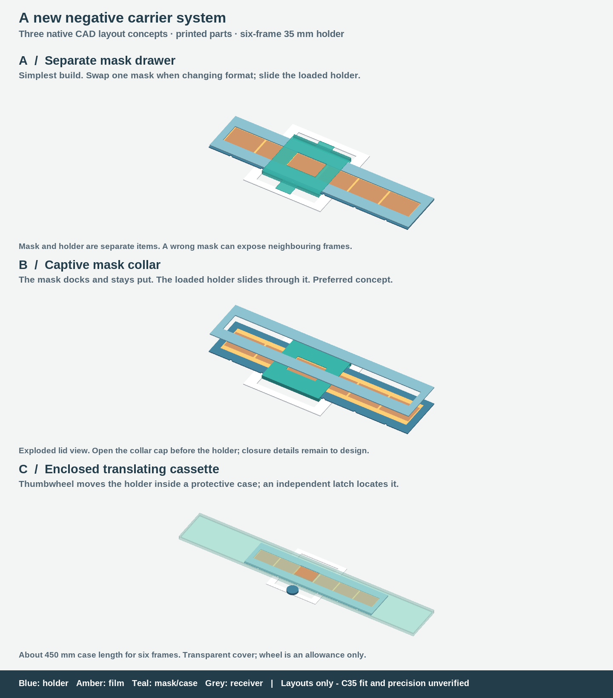

# Preloaded negative-strip cartridges: concept study

**Preferred direction: B, a clamped strip holder with a captive, format-specific mask collar.** The collar seats in a receiver that stays in the Durst C35. The holder moves through the collar; a replaceable printed latch locates each frame. Changing formats exchanges the holder and its matching mask together.

**The selected design is now developed as [B1, with full-length parts and operating videos](../negative-carrier-b/README.md).** This page preserves the earlier architecture comparison and its evidence. These concept solids establish envelopes and optical openings; they omit the detailed clamps, locks and springs implemented in B1. The concept STEP files should not be sent directly to a printer.



## Requirements captured

- Prepare many complete strips in the light; handle closed plastic holders in the dark.
- Prefer slide-and-click advancement, entirely printed parts, six full-frame 35 mm pictures and longer half-frame strips.
- Support 35 mm full frame, half frame, APS and 110; defer medium format.
- Return to a frame after advancing or removing the holder without relying on eyeballing the projected image.
- Keep every frame usable while masking neighbouring images.

The receiver and cartridges are a new system. They do not replace or revise the original-carrier clone in [PR #2](https://github.com/karlsander/paper-slot-processor/pull/2). This branch starts at `origin/main` commit `7ba290c` and has no dependency on that unmerged PR.

## Three workable architectures

| Concept | Handling and indexing | Format masking | Main tradeoff |
| --- | --- | --- | --- |
| **A: separate mask drawer** | Slide the closed strip holder through a receiver; printed detent at each station. | A thin, keyed mask drawer stays in the receiver. Change it when changing format. | Fewest cartridge parts, but one extra darkroom operation and the possibility of selecting the wrong mask. |
| **B: captive mask collar** | Dock the collar, then slide the holder through it. Squeeze a release to advance; let go for a click. Remove collar and holder together. | Each holder carries its matching stationary aperture. | Best match to quick format swaps. Needs a reliable two-piece collar, dock latch and film-holder closure. |
| **C: enclosed translating cassette** | Dock the whole case; turn a printed thumbwheel/rack to translate an internal closed holder. A separate locating latch supplies the frame datum. | The case has one format-specific aperture. | Protects the film and avoids protruding moving handles, but a six-frame case is about 450 mm long. Gear backlash must not define image position. |

All three use the same principle: **the film and its clamp move together; the aperture stays at the optical axis**. A frame-sized hole repeated in a moving carrier cannot alone solve small-format masking: a larger stationary light window can still reveal adjacent holes. A rotary selector mask is another possible receiver, but it adds a format-setting operation and alignment mechanism without improving B. A rolling/spooled cassette is compact but requires moving bare film, tension control and curved storage; it conflicts with the desired pre-clamped strips. These alternatives are deferred.

## How B would work

1. At the loading bench, open the collar cap and then the holder lid. A collar closed around the middle of the holder would obstruct lid opening; the exploded rendering is not an opening trajectory. A split collar with captive printed hinge pin and two clips is the proposed solution.
2. Place the strip against one lateral reference edge. Align its first image using a loading jig; clamp the film margins and a blank end region. Close a rigid lid with several small compliant fingers, using printed pin joints and independent snap catches. Avoid a long living hinge whose performance would depend on repeated bending.
3. Close the collar. It remains captive between removable end stops. Use a matching tactile format mark on both pieces, an asymmetric docking key, and raised strip ID and frame numbers.
4. With the enlarger lamp off, slide the assembly rearwards into the fixed receiver until the collar reaches its references and latches. The strip then travels sideways, in X. This orthogonal docking/travel arrangement requires inspection of the C35's actual side access and front approach.
5. Squeeze the large release paddle, slide to another frame, then release it to engage the next index. This is a click after release, not a high-force ratchet that jolts the enlarger. A visible/tactile fully-seated paddle state should distinguish an index from an intermediate position.
6. Release the separate dock latch to remove the complete loaded assembly. Its end stops retain the collar. The receiver remains seated in the enlarger throughout the session.

The model currently uses continuous edge supports, not fixed bars between every image. A rigid grid is convenient only when the actual frame spacing matches it. Optional thin gap bridges could be fitted after checking a strip, but cannot be assumed safe across camera types. Edge fingers should contact only non-image margins, with clean smooth contact surfaces; the narrow 110 margins need particular inspection. Film flatness, slip and scratching must be tested on expendable processed film. No force or contact-pressure result is claimed here.

## Repeatability has four interfaces

| Interface | Proposed locating method |
| --- | --- |
| C35 → fixed receiver | Rear stop plus one side reference, with the existing stage supplying vertical pressure and a printed wedge supplying lateral preload. Exact head contacts are still unknown. |
| Receiver → collar | Three Z support pads, two contacts on one Y reference edge and one X end reference. A compliant latch supplies seating force. Other surfaces have clearance. |
| Collar → holder | Three Z pads, two Y guide contacts and a replaceable index rail for X. Separate printed springs keep the holder against its references. |
| Holder → film | Edge registration plus blank-end clamp, with distributed lid fingers holding the film. This clamp stays closed during all frame selection and cartridge swaps. |

The click must have a defined stop surface. Proposed index detail: a rigid tooth seats against one face of a pocket while a compliant opposing ramp biases it toward that face. The release paddle retracts it completely for either travel direction. This avoids expecting a loosely fitting round pin, gear tooth or friction grip to provide precision. Printed leaf springs and index rails are replaceable wear parts; no magnets, metal springs or screws are required by the concept. Their detailed geometry, release travel, stress, creep, lifetime and bump resistance are unverified.

Start with a nominal fixed-pitch index rail and a first-frame offset adjustment at loading. For irregular spacing or shrunken film, use **individual index positions** copied from that strip: either a replacement rail generated from measured image centers or independently adjustable stop blocks locked by printed wedges. The analytical model accepts arbitrary valid center positions; the current CAD pockets show nominal stations only. An adjustable rail is a design option, not an implemented part. Nothing should engage unmeasured sprocket holes or depend on their phase relative to the image.

Repeatability at the paper is the negative-plane error multiplied by enlargement. For example, 0.02 mm of movement becomes 0.20 mm at 10× and 0.40 mm at 20×. Therefore an all-printed click is a reasonable first experiment, but its suitability for repeated exposures cannot be established by an ideal CAD animation. Dust, wear, film motion, receiver motion, yaw and changes in flatness all contribute.

## Formats and masking

Dimensions below are layout inputs, not manufacturing tolerances. X is along the strip. The aperture illustration crops 0.2 mm from each image edge. Actual masks need tuning for the desired image border, camera gate and lens cone.

| Format | Nominal film width | Example image X × Y | Demonstration pitch | Frames in model |
| --- | --- | --- | --- | --- |
| 35 mm | 35 mm | 36 × 24 mm | 38 mm nominal template | 6 |
| Half frame | 35 mm | 18 × 24 mm, camera dependent | 19 mm nominal template | 12 |
| APS | 24 mm | 30.2 × 16.7 mm | **32 mm illustrative only** | 6 |
| 110 | 16 mm | 17 × 13 mm | **20 mm illustrative only** | 6 |

The APS and 110 pitches were not established from a dimensional standard and must be replaced by actual strip-center measurements. Half frame is not universally 18 mm wide: Ricoh specifies 17 × 24 mm for the Pentax 17. Canon specifies the APS camera image as 30.2 × 16.7 mm with C/H/P print-format metadata; those crop modes do not require different advancement pitches. A full APS gate plus an easel crop is the simplest starting point. These are film dimensions, not digital APS-C sensor dimensions. [Ricoh](https://news.ricoh-imaging.co.jp/rim_info2/2024/20240618_040028.html), [Canon](https://global.canon/en/c-museum/product/film198.html), [Lomography 110 manual, printed p. 5](https://cdn.downloads.lomography.com/downloads/fisheye-baby-manual.pdf).

VALOI's own holder range demonstrates the practicality of format-specific masking for 35 mm, half frame, APS and 110; its published page does not establish repeatable enlarger registration or this proposed captive-collar mechanism. [Manufacturer reference](https://valoi.co/en-us/products/easy35-film-holder).

At a 110 station, the illustrative 20 mm pitch and a 36 × 24 mm opening reveal a total 169 mm² of the two neighbouring images at interior stations. A 16.6 × 12.6 mm aperture reveals none in the normal-ray model. Advancing 20 mm puts the next frame behind the same hole; no frame must be permanently covered or skipped. The interactive comparison demonstrates both cases. No inference about actual 110 pitch or diffuse/oblique stray light follows from this example.

## Packaging and unresolved fit

- Six 35 mm frames give a 244 mm holder and 190 mm travel in this layout. The full working sweep occupies about 434 mm laterally. The later B1 design adds end-stop clearance and uses a 263 mm holder for twelve half frames; use its dimensions for the detailed prototype.
- The user has selected a larger printer. B1 uses a single-piece base and lid, with no modular joints. The earlier A1 mini constraint no longer applies to this carrier project.
- The compact collar allocates **4.7 mm** to two 0.8 mm masks, two 1.2 mm holder layers, a 0.2 mm film space and two 0.25 mm running gaps. This is a candidate budget, **not** a measured C35 allowance. It is thicker than the earlier 2.6 mm ordinary shell stack. Recessing the masks near the optical opening or thinning local structures may be necessary. Changing the receiver cannot create space inside the head.
- The 94.6 × 100 mm receiver outline carries forward a prior reference envelope only. Actual dock retention, spring-stage seating, side passages, film height, lamp heat and lens-side cone clearance remain unknown. The current CAD receiver is a layout ring, not a C35 mounting solution.
- The clearances shown around film are placeholders, not a clamping solution. The model contains no force-bearing contact fingers.
- Use opaque baffles above and below the strip, overlapping masks and labyrinth side ports. A manual dark slide or lamp-off transport is necessary during selection and undocking; the concept does not yet model a shutter or prove light-tightness. Test with the actual light source. Thin black printed walls alone are not proof of opacity.
- Keep the film plane common across formats. Different enlargement ratios still require the normal enlarger height, focus and exposure changes.

## What was checked, and what to prototype next

The six generated assemblies are A/B/C in 35 mm plus B in half frame, APS and 110. Each STEP part is one valid solid. FreeCAD independently reimports the STEP files, checks volume preservation, samples the entire first-to-last frame travel, includes every exact station, checks the aperture/frame intersections, and saves/reopens each FCStd document. A deliberately lowered gate must collide, and an oversized 35 mm aperture must reveal adjacent 110 images. The film image markings in the render are annotations, not additional CAD solids. The exploded lid and translucent covers are explanatory views, not verified assembly motions.

No continuous swept-volume, optical ray-cone, docking/removal, hinge, clamp, spring, stress, thermal, slicing or physical repeatability test is claimed. See `evidence/freecad-validation.json` for the exact sampled results and `evidence/manifest.json` for input dimensions and hashes. A successful concept check does not mean the part fits the C35 or holds film.

The smallest useful physical next step is a registration test with the printed latch and reference pads. Measure repeated approach from both directions, removal/reseating, light bumps and warm operation before printing a day's worth of holders. The [B1 prototype](../negative-carrier-b/README.md) supplies the full-length holder and its actual closure and guide geometry for that test. Compare registration at the projected image and check margin marking, flatness, edge illumination and light leaks.

Measurements needed at that stage: actual C35 contact planes and side openings; available vertical space at the gate; receiver stop locations; film strip lengths, widths and image-center spacing; acceptable paper-plane registration error at the intended enlargement. None is required to choose between these architectures now.

## Reproduction

```sh
python -m pip install -r cad/requirements.txt
python -m unittest discover -s tests -p test_negative_carrier_concepts.py
FREECAD_CMD=/path/to/freecadcmd python scripts/check_negative_concepts.py
python -m pip install -r cad/requirements-concept-render.txt
python scripts/render_negative_concepts.py
```

`explore.html` is an inline interactive explainer. It uses the same documented demonstration values but is not a CAD viewer or a physical simulation. All native sources are in `cad/negative_carrier_concepts/`. The hosted workflow repeats the optical tests and native/FreeCAD checks.
