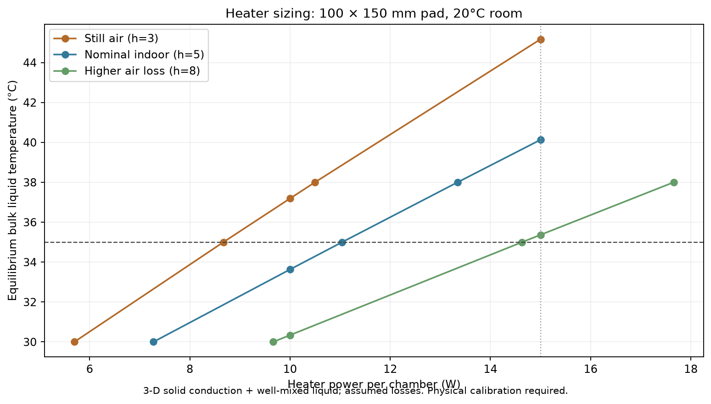

# Processor physics and PETG print audit

This study uses OpenFOAM v2606 finite-volume solvers for the native 16:9 bath,
with water as a proxy for chemistry. It is a predictive engineering model, not
measured performance of a printed vessel. The five-part v1.8 remains unheated;
the thermal cases add the proposed external v2 heater stack to its flat rear.

## What is modeled

**Filling:** three-dimensional `interFoam`, solving incompressible water/air
volume fraction, momentum and pressure with gravity, viscosity and surface
tension. An initially empty 122 × 14 × 200.33 mm cavity receives 323 ml through a
centered 12 × 6 mm downward jet over five seconds, then settles for two seconds.
A separate coarse run pours for ten seconds. The top is open; water can leave
through the atmospheric opening. Inlet/outlet phase fluxes and stored water are
recorded separately. This is computed fluid motion, unlike the earlier CAD
animation that simply raised a liquid surface.

The mesh target is 4, 2.5 or 2 mm; individual block subdivisions can be smaller.
These meshes do not resolve droplets or capillary-scale surface details. The
rounding, bottom paper stops and 0.4 mm fill ridge are omitted, as are bottle
shape, hand motion and calibrated wetting/contact angle. The laminar model
resolves motion on the mesh but is not a validated turbulence/splash model.
Do not infer a precise safe pour rate or spill amount from these runs.

**Heating:** three-dimensional transient `chtMultiRegionFoam`, coupling buoyant
laminar water flow to heat conduction through PETG, a compliant pad, aluminium
spreader and heater. The 3 mm PETG wall, 4 mm floor and liquid level follow the
16:9 design. Rectangularization gives 324.03 ml versus the CAD's 323 ml (+0.32%).
No paper/agitation is present. The liquid is already in place at time zero;
thermal exchange *during pouring* is not coupled to the VOF calculation.

The heater stack follows the earlier v2 proposal: 124 × 179 × 0.5 mm pad,
156 × 182 × 1.5 mm aluminium and a 140 × 150 × 3 mm heater, supplying a total
of 5 W (not 5 W per cell or per bath pair). It is an isolated chamber model;
base contact, straps, neighboring bath and actual heater internals are omitted.
Interface contact is perfect apart from the explicit pad's resistance.

| Material | Density kg/m³ | Heat capacity J/(kg K) | Conductivity W/(m K) |
| --- | ---: | ---: | ---: |
| Water | 998 | 4180 | 0.6 |
| PETG | 1270 | 1200 | 0.2 |
| Compliant pad | 1800 | 1000 | 1 |
| Aluminium | 2700 | 900 | 205 |
| Heater equivalent solid | 1400 | 1200 | 0.2 |

These are assumed constant engineering properties, not measurements of the
ordered components or filament. Water uses the Boussinesq density relation with
β = 0.0003/K and viscosity 0.0008 Pa s. Printed PETG is treated as isotropic,
fully dense material; porosity and directional layer bonding are not resolved.

Room temperature is 20°C. Exposed solids use convection h = 5 W/(m² K) and
surface radiation (emissivity 0.9, aluminium 0.15). The free surface uses an
effective h = 3 plus radiation to represent the headspace/slotted top; the
top's mass is omitted. Sensitivities use outside h = 3 and 8, and surface h = 30.
The last is an increased-loss bracket, **not an evaporation transport model**.
No humidity, vapor concentration or evaporated mass is calculated.

## Results and interpretation

The machine-readable results, temperature curves, conservation accounting and
movies are distributed with the dated artifact bundle. The report separates
coarse and refined fill predictions rather than averaging them into a result.

The model predicts that a 5 W pad slows cooling but cannot hold a 35–38°C bath
in a 20°C room with this exposed geometry. Starting with a cold vessel produces
a rapid initial drop as the walls and heater assembly warm up. Preheating the
whole assembly reduces that initial drop, but does not remove ongoing losses.
As an independent energy sanity check, the modeled water has about 1350 J/K of
heat capacity and the solids about 505 J/K. Even with perfect insulation and no
heater input, 38°C water and 20°C solids would equilibrate near 33.1°C.
"Heater off" in this study still includes the attached heater stack; it is not
the bare, unheated five-part v1.8 configuration.
Starting from 20°C is slow: 5 W has to warm both liquid and assembly while
continually losing heat to the room. The liquid also develops vertical thermal
gradients; an average temperature alone does not establish processing uniformity.

### Equilibrium and heater choice

Hot fill changes the time to settle; it does not raise the final equilibrium at
fixed power and ambient conditions. A separate **steady 3-D finite-volume solid
conduction model with a well-mixed liquid node** sizes the replacement heater.
It shares the thermal geometry and solid conductivities above, adds a liquid-side
film coefficient of 300 W/(m² K), and iterates surface radiation to convergence.
It does not solve water velocity or prove liquid uniformity. A steady CFD pilot
failed to converge and is excluded; no results from it are presented as equilibrium.

The replacement pad is 100 × 150 × 1.4 mm. At 20°C room temperature:

| External convection h, W/(m² K) | Power for 30°C | Power for 35°C | Power for 38°C | 15 W equilibrium |
| --- | ---: | ---: | ---: | ---: |
| 3, still-air bracket | 5.70 W | 8.67 W | 10.50 W | 45.17°C |
| 5, nominal indoor | 7.27 W | 11.04 W | 13.34 W | 40.13°C |
| 8, higher-loss bracket | 9.67 W | 14.63 W | 17.66 W | 35.37°C |

The original 140 × 150 × 3 mm **5 W** stack equilibrates at **26.47°C** in the
nominal model. This lies between the hot- and cold-start transient values at one
hour (28.63°C and 24.46°C). The narrower 10 W replacement reaches 33.63°C nominally.

**RS PRO 731-350, 12 V DC, 15 W, 100 × 150 × 1.4 mm** is a concrete candidate for
controlled 35°C operation in a 20°C indoor room, bonded to the aluminium spreader
rather than immersed or glued directly to the vessel. The dimensions, power and
self-adhesive backing are in the [manufacturer datasheet](https://docs.rs-online.com/ba83/A700000008849926.pdf);
[RS Germany lists the part](https://de.rs-online.com/web/p/heizmatten/0731350).
The 100 mm width fits the 128 mm bath and proposed spreader. Final mounting height,
lead exit, contact pressure, thermal cutoff and base interference remain design work.

Use temperature feedback per chamber: an always-on 15 W pad would run above the
35°C target in the nominal case. The modeled hold power at 35°C is about 11 W,
or 74% of nominal 15 W power. Two pads draw 2.5 A at 12 V at full power; a regulated
12 V supply with useful margin (for example 4 A) can serve both controller channels.
A heater-side overtemperature cutoff is also needed because liquid regulation
does not cover an empty vessel or detached sensor. These are design requirements,
not an installed or validated control system.

15 W has almost no margin at the higher-loss 35°C point and cannot promise 38°C
in a draft. For a robust higher-loss version, target approximately **20 W per
bath** with feedback and a suitable custom-sized heater, or reduce verified losses;
a drop-in 20 W product has not been established here. Do not treat a reptile
mat's power dial as temperature control or enclose it against its ventilation rules.

At nominal air loss, the 15 W model gives 38.30°C in an 18°C room and 38.68°C with
the increased free-surface loss bracket. Halving the solid grid target from 6 to
3 mm changes equilibrium by 0.09°C. Liquid film coefficients 100–500 change the
bulk prediction by under 0.04°C but change heater hot spots. Steady energy residuals
are below 1e-6 W; a one-node analytic resistance test and a zero-power equilibrium
check validate bookkeeping. These numerical checks do not calibrate air loss,
evaporation, printed PETG properties or real contact resistance.



### Transient and fill results

| Initial water / assembly, power | Mean liquid after 10 min | After 60 min |
| --- | ---: | ---: |
| 38 / 20°C, off | 31.53°C | 24.23°C |
| 38 / 20°C, 5 W | 32.39°C | 28.63°C |
| 20 / 20°C, 5 W | 20.85°C | 24.46°C |
| 38 / 38°C, 5 W | 36.00°C | 29.93°C |

At ten minutes, halving the time step changes the hot/5 W mean by 0.0017°C,
using the 4 mm mesh changes it by 0.0189°C, and doubling coupling correctors changes
it by 0.0018°C. Completed thermal energy residuals are below 0.40% of the stated
energy scale. The uniform heater-off case drifts by less than 0.00002°C.

The five-second pour predicts 34.67, 15.38 and 11.74 ml escaping at 4, 2.5 and 2 mm
mesh targets. The two finest meshes still differ by 3.64 ml, so these are **not
converged spill quantities**. Volume-accounting residuals are under 0.017 ml.
The ten-second pour has only a coarse run and cannot establish that slower pouring
is better or worse. The videos show computed fluid/thermal fields with these limits.

[Compact numeric results](../simulation/physics/evidence/2026-10-28/results.json),
[equilibrium cases](../simulation/physics/evidence/2026-10-28/equilibrium.json), and
[temperature curves](../simulation/physics/evidence/2026-10-28/thermal-curves.png)
are checked in. Full movies and run inputs are in the dated local delivery bundle.

## Numerical checks

The thermal baseline uses a nominal 6 mm x/z target and ≤2 mm through depth,
with conforming thinner solid layers. A 4 mm mesh and a halved time step are
compared over the first ten minutes. The initial hot-water/cold-wall transient
uses a 0.005 s starting step, with four outer coupling correctors throughout and
steps capped at 0.5 s. An eight-corrector run also checks coupling sensitivity.
This avoids the spurious temperature overshoot found with two correctors in the
exploratory runs. Only the corrected
cases belong in the final results. The nominal liquid-temperature averages are
less sensitive to mesh/time step than the fill model's splash quantity.

Sensible-energy storage uses reference density × Cp × region volume × ΔT.
It is compared with supplied power and integrated external wall heat flux.
The residual includes the Boussinesq approximation and sampled flux quadrature;
it is reported explicitly, not silently forced to zero. A uniform 20°C,
heater-off case checks temperature drift. Filling is independently checked via
water volume in, volume out and volume retained; mixture mass flux is converted
to water volume flux using both phase densities. Restart records are joined by
physical time without double-counting duplicate samples.

The cold-start heated case still has a localized numerical undershoot of about
0.33°C near the pressure-reference cell during the first minutes. It must not be
interpreted as real cooling below room temperature. Mean-temperature refinement
and global energy checks do not validate every local extremum; the movies and
spatial gradients remain exploratory and need comparison with physical probes.

## PETG features and nozzle checks

The end ledges increase from 11 to 12 mm. The
minimum plastic beside the top's magnet pockets grows from 0.8 to **1.3 mm**.
The shared base is now 180 × 180 mm, with a 16 mm taper and 16 mm exposed
straight sleeves above its 4 mm floor, and 45 mm chamber pitch. Its five-part count is unchanged. Updated top width is 160.45 mm;
vessel flange width is 152 mm. Both presets retain A1 mini fit.

| Feature | Nominal size | Interpretation |
| --- | --- | --- |
| Vessel wall / floor | 3 / 4 mm | Engraved vessel letters leave at least 2.4 mm wall |
| Base floor / socket wall at top | 4 / 3 mm | Lettering is on the substantial central bridge |
| Locating rim | 1.2 mm thick × 1.5 mm high | Several bead widths with the 0.4 mm nozzle |
| Fill ridge | 0.4 mm projection × 0.6 mm height | Wall-backed bump, not a free-standing 0.4 mm wall |
| Magnet outer ligament | 1.3 mm minimum | Increased for handling strength |
| Pocket floors | 1.3 mm top / 1.8 mm vessel | Blind pockets remain dry |
| Pull tab / top | 4.5 mm thick | Engraved tab letter leaves 3.9 mm |
| Slot wiping land | 0.4 mm high | Two 0.20 mm or four 0.10 mm layers in the inverted top |
| Tactile bars / bottom stops | 2 mm wide / Ø4 mm | Connected to substantial material |
| Sacrificial bed rail | 0.4 mm high | Intentionally thin and removed after printing |

Tested in Bambu Studio 2.7.1.57 using its resolved **Generic PETG / A1 mini**
profiles, with four walls and 1.2 mm top/bottom shell thickness:

- 0.4 mm nozzle, 0.20 mm Standard: six top/bottom layers.
- 0.2 mm nozzle, 0.10 mm Standard: twelve top/bottom layers.
- Vessels: supplied 44.2° tilt, build-plate tree supports at 30°, 3 mm outer brim.
- Tops inverted; base flat; neither needs supports or brim. No auto-orientation.

All five final 16:9 plates, both 2:1 vessels and the differently labeled 2:1 base slice
without warnings for both nozzles (16 plate/nozzle runs). The tops are identical
between presets.
Deposition probes cover the fill ridge's straights and rounded corners, rim
straights, slot land, magnet outer ligament and pocket floor: 100% of the sampled
points are within intended extrusion footprints at both nozzle sizes. This
uses reported bead width and layer height with 0.055 mm sampling tolerance;
it is not a global minimum-wall tomography or a physical bead-shape model.
FreeCAD independently re-imports both STEP sets and checks solid validity,
clearances, pocket floors, ridge continuity, rigid paper movement and bath removal.
FreeCAD and build123d share Open Cascade, so this is not an independent geometry kernel.

**0.4 mm is the practical first-print choice** based on these toolpaths. The
0.2 mm nozzle is usable but substantially slower. No slicer can establish
watertightness, rim durability, magnet/adhesive retention or chemical compatibility.
Inspect supports and make the first water/fit trial before using chemistry.

## Print time and material

Bambu estimates include generated supports and brims. These are toolpath estimates,
not measured machine time; failed prints and handling time are excluded. Each part
is a separate plate. These numbers include the half-height taper revision and supersede both the
rectangular and full-height-taper base estimates. Current base slices and fit
checks are in [the half-height revision evidence](evidence/v1.8-half-taper.json);
the earlier physics evidence folder remains a historical snapshot.

### 16x9

| Part | 0.4 mm time | PETG | 0.2 mm time | PETG |
| --- | ---: | ---: | ---: | ---: |
| Base | 7h 48m 27s | 222.16 g | 46h 39m 07s | 188.31 g |
| Chamber A | 9h 12m 27s | 235.76 g | 52h 06m 28s | 207.17 g |
| Chamber B | 9h 11m 47s | 236.18 g | 52h 11m 10s | 207.32 g |
| Top A | 0h 26m 27s | 10.64 g | 2h 24m 14s | 9.58 g |
| Top B | 0h 26m 26s | 10.64 g | 2h 24m 18s | 9.58 g |
| **Total** | **27h 05m 34s** | **715.38 g** | **155h 45m 17s** | **621.96 g** |

### 2x1

| Part | 0.4 mm time | PETG | 0.2 mm time | PETG |
| --- | ---: | ---: | ---: | ---: |
| Base | 7h 47m 41s | 222.16 g | 46h 38m 18s | 188.31 g |
| Chamber A | 10h 09m 20s | 259.25 g | 57h 40m 38s | 228.96 g |
| Chamber B | 10h 11m 33s | 260.98 g | 57h 41m 11s | 229.01 g |
| Top A | 0h 26m 27s | 10.64 g | 2h 24m 14s | 9.58 g |
| Top B | 0h 26m 26s | 10.64 g | 2h 24m 18s | 9.58 g |
| **Total** | **29h 01m 27s** | **763.67 g** | **166h 48m 39s** | **665.44 g** |

## Reproduce

Install OpenFOAM v2606 (native OpenFOAM.app on this Mac, or a sourced OpenFOAM
installation on Linux), Bambu Studio and the existing FreeCAD runtime.

```sh
uv pip install --python .venv-cad/bin/python -r simulation/physics/requirements.txt
.venv-cad/bin/python simulation/physics/equilibrium.py build/heater-sizing
.venv-cad/bin/python simulation/physics/run_thermal.py build/example-hot --hot 38 --power 5
.venv-cad/bin/python simulation/physics/run_thermal.py build/example-cold --hot 20 --power 5
.venv-cad/bin/python simulation/physics/fill.py build/example-fill --spacing 2.5 --pour-seconds 5
openfoam interFoam -case build/example-fill > build/example-fill/log.solver 2>&1
.venv-cad/bin/python simulation/physics/render.py fill build/example-fill build/example-videos
.venv-cad/bin/python scripts/check_native.py --output build/print-model
.venv-cad/bin/python scripts/check_native_print.py build/print-model/16x9 build/sliced-04 --nozzle .4
.venv-cad/bin/python simulation/physics/print_paths.py build/sliced-04
```

On a sourced Linux installation omit the `openfoam` launcher before solver names.
The run wrapper detects the launcher automatically. Use fresh output folders;
keep `0/`, `constant/`, `system/`, scenario JSON, logs and postProcessing data.
`analyze.py CASE_ROOT REPORT_FOLDER` expects the named suite in the dated bundle;
`render.py thermal CASE_ROOT REPORT_FOLDER` renders the three principal cases.
For parallel VOF runs, use `decomposePar`, `mpirun -np 4 interFoam -parallel`,
then `reconstructPar` before rendering. Full volumetric fields are large and
remain local; Git contains source and compact evidence, not multi-gigabyte runs.

References: [OpenFOAM solver descriptions](https://www.openfoam.com/documentation/user-guide/a-reference/a.1-standard-solvers),
[conjugate heat-transfer solver](https://doc.openfoam.com/2212/tools/processing/solvers/rtm/heat-transfer/chtMultiRegionFoam/),
[native OpenFOAM.app](https://github.com/gerlero/openfoam-app),
[IAPWS water-property releases](https://www.iapws.org/release.html).
Actual numerical schemes and boundary dictionaries are saved with each case;
water constants here are approximations rather than a full IAPWS implementation.
