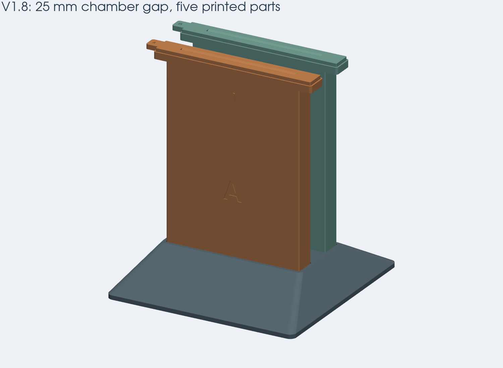
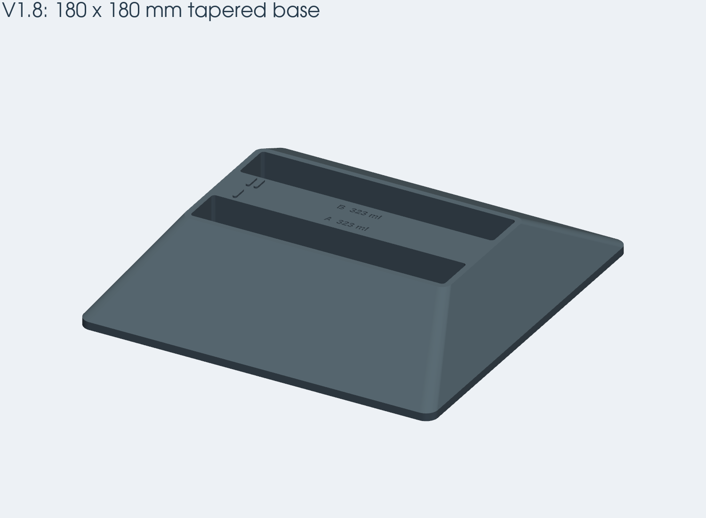

# Paper processor v1.8 — five parts, unheated

V1.8 now consists of exactly **five printed parts**: one shared base, two bath
chambers and two removable slotted tops. There are no clips, separate closing lids
or side filling wells. Use the [native build123d workflow](native-processor.md)
for the current STEP files, print plates, FreeCAD checks and video.



## Parts and hardware

| Print plate | Quantity | Role |
| --- | ---: | --- |
| `base` | 1 | One stand with two sockets and A/B fill labels |
| `vessel_a`, `vessel_b` | 1 each | Bath, bottom paper stops, continuous fill ridge, locating rim and magnet seats |
| `guide_a`, `guide_b` | 1 each | Slotted top with integral pull tab and mating magnet seats |

Print each of these five plates once. Each vessel's sacrificial bed rail is removed
before assembly. No optional covers, trial tops or fit samples are exported.

Add **eight nominal Ø6 × 3 mm disc magnets**: two in each chamber and two in each
top. The blind glue pockets are Ø6.3 × 3.2 mm. The end ledges leave at least
1.3 mm of plastic beside the top pockets, increased from the initial 0.8 mm. Chamber pockets open upward; top
pockets open downward. They sit on dry end ledges outside the wet walls. A seated
pair has a nominal 0.4 mm face gap when both magnets are fully bottomed, before
allowing for glue thickness. Check polarity and dry fit before gluing; keep magnet
faces recessed so the plastic seating faces can meet. Adhesive thickness, actual
magnet dimensions, printing tolerances and holding force still need a physical trial.

The top rests on a ledge inside a **1.2 mm outer rim**, with **0.35 mm clearance per
side**. The rim locates it laterally; magnets retain it vertically. An integral
10 mm pull tab passes through a notch in the rim. The slotted top is not a storage
closure or a liquid seal.

## Build and print

```sh
uv venv --python python3.13 .venv-cad  # omit when already present
uv pip install --python .venv-cad/bin/python -r cad/requirements.txt
.venv-cad/bin/python -m cad.export --output build/magnetic-16x9
.venv-cad/bin/python -m cad.export --aspect 2 --output build/magnetic-2x1
```

Use `plates/*.stl` or `plates/*.step` for printing. The other STEP files are design
coordinates, assembly or validation geometry. The exporter rejects an output folder
containing obsolete covers/clips so they cannot be mistaken for current parts.

The shared base now uses the full **180 × 180 mm** A1 mini footprint. A rounded
4 mm floor slopes up to a 135.2 × 72.2 mm socket platform at 36 mm; tactile bars
reach 37 mm. Both chambers seat 32 mm deep with 0.6 mm clearance per side.
Center spacing is **45 mm**, giving **25 mm between the 20 mm bodies**, reduced
from the previous 70 mm pitch / 50 mm gap. The wide footprint and tapered support
are intended to improve stability; tipping resistance has not been physically tested.

The previous 170.8 × 138 mm base already fitted the A1 mini. This revision uses
more of the bed for support. Both 180 mm base variants slice without warnings
with the A1 mini's installed profiles, no brim and no supports. There is no spare
XY margin for adding a brim. Vessel plates retain the reserved 174 × 174 × 178 mm
envelope inside the printer's 180 mm build volume and the supplied 44.2° tilt.



For the 0.4 mm nozzle, use PETG, 0.20 mm layers, four walls and six top/bottom layers.
For the 0.2 mm nozzle, the tested profile uses 0.10 mm layers, four walls and twelve
top/bottom layers. The 0.4 mm nozzle is sufficient for the tested small features.
The base and inverted tops print flat. Vessel plates include a sacrificial bed
rail and require slicing with build-plate tree supports and a 3 mm outer brim.
Keep their supplied tilt and placement; do not auto-orient or scale individual parts.
Bambu Studio 2.7.1.57 sliced all five 16:9 plates and both taller 2:1 vessels with
both nozzle profiles without warnings. Sampled deposition paths preserve the
fill ridge (including corners), locating rim, slot land and magnet pocket walls
and floors. See [the print audit and physics study](processor-physics.md) for
settings, evidence and the distinction between toolpaths and physical results.

## Fill and use

| Preset | Paper cut | Fill per empty chamber | Whole-ml 1+4 mix |
| --- | --- | ---: | ---: |
| 16:9 | 102 × 208 mm | 323 ml | 65 + 258 ml |
| 2:1 | 102 × 230 mm | 360 ml | 72 + 288 ml |

The default whole-ml mix is rounded; use 64.6 + 258.4 ml for exact 1+4 at 323 ml.
Recipe ratios remain independently configurable. Volumes differ from the earlier
side-well design; use the markings and settings from the current exported set.

1. Seat both empty chambers in the shared base on a level surface.
2. Lift each slotted top by its tab and pour directly into the open chamber.
3. Fill to the **upper edge** of the continuous inside ridge, with no paper present.
   The ridge projects 0.4 mm inward and is 0.6 mm high; its displaced volume is
   included in calibration. Let the surface settle before judging the level.
4. Refit each magnetic top. Hold the paper's handling strip and lower it through
   the 1.2 mm slot to the rounded bottom stops. The design permits 6 mm vertical
   and ±3 mm lateral agitation, retaining at least 6 mm freeboard.
5. Remove tops and lift each chamber out for emptying and rinsing. Keep A/B wet
   parts identified and separate during cleaning. The base is a stand, not a tray.

Test with water and scrap paper first. Digital checks do not establish printed fit,
leak tightness, wet-paper friction, chemical compatibility or magnet retention.
Use the light, timing, temperature and washing instructions for your paper and
chemistry. No heater or temperature control is included.

## Future heating and older files

The body, flat rear surface and bottom mating geometry remain reusable for future
heating. The old large spacing came from the earlier heater arrangement; the
unheated version did not need all of it. The new 25 mm gap leaves space to develop
a thin heater/spreader assembly, but **the complete old v2 frame is not a drop-in
fit**. The base surrounds the bottom 32 mm of each chamber, so future heaters
need a revised mounting height or relief there. This base includes no heater mounts.
The thermal study considers an isolated chamber and does not validate a complete
heater assembly inside this new base. See [heater sizing](heating.md).

`v1_8/*.scad` and `scripts/build_v1_8.py` retain the earlier clip-and-well design as
historical references. The existing browser viewer and v2 build scripts describe
the older heated configuration. They do **not** generate this five-part revision.
