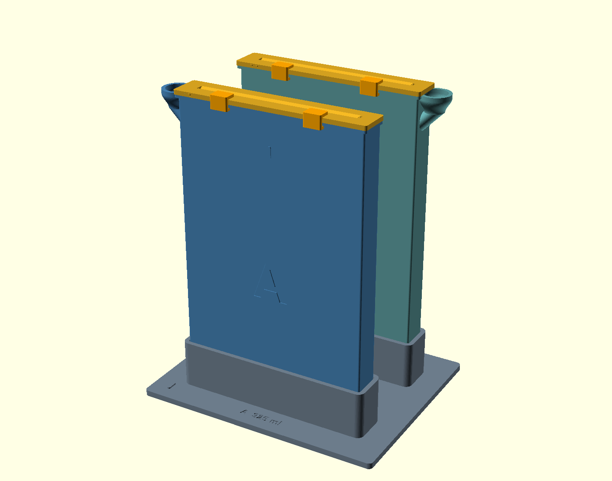
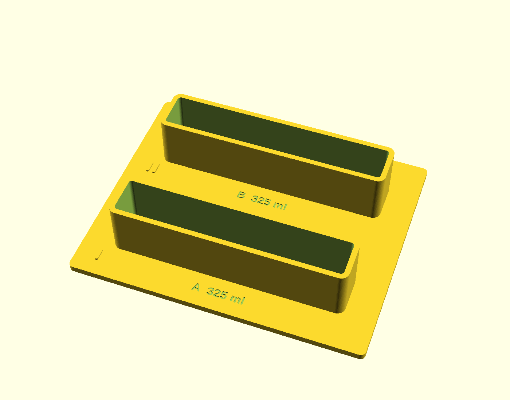

# Paper processor v1.8 — unheated, shared base

V1.8 is the first wet-test configuration: two removable v2 bath vessels in a
single printed stand. There are no heaters, metal plates, straps, mounting
fittings, joining links or assembly screws.



The base is **170.8 × 138 mm**, with a 4 mm floor and 32 mm tall locating sockets
(36 mm total height). It fits the **180 × 180 mm A1 mini bed**, including the
project's 3 mm edge reserve. The previous split bases were for independently
expandable heater modules, not because the combined footprint exceeded the bed.
The slots retain their 70 mm spacing. Each socket has 0.6 mm clearance per side;
this is a slip fit, not a snap fit. Physical fit and stability remain untested.



## Parts

| Print file | Physical pieces | Role |
| --- | ---: | --- |
| `base` | 1 | One flat stand with two locating sockets, A/B labels and fill volumes |
| `vessel_a`, `vessel_b` | 2 | Separate one-piece baths, including fill wells and paper stops |
| `guide_a`, `guide_b` | 2 | Removable slotted tops |
| `clips` | 4 | Two retaining clips for each guide |
| `cover_a`, `cover_b` | 2 optional | Resting covers in place of guides; not sealed storage lids |
| `fit` | 1 optional | Small rim sample for checking guide and clip fit |

The working processor contains **9 printed pieces**. Covers bring that to 11.
Print every selected plate once; the `clips` plate already contains all four clips.
The sacrificial rail on each vessel is removed after printing and is not an assembly part.

## Build and print

```sh
python3 -m pip install -r requirements.txt
python3 scripts/build_v1_8.py --covers --fit
python3 scripts/build_v1_8.py --aspect 2 --output build/v1.8-wide
```

OpenSCAD with Manifold and Bambu Studio are required for the complete build.
`--mesh-only` exports validated STLs without slicing. The default output is
`build/v1.8-print/processor-v1.8-print-files.zip`, containing STL and Bambu projects,
a quantity manifest, configuration, these instructions and a source snapshot.
To print only the new base, use `python3 scripts/build_v1_8.py base`.

The shared base prints flat without supports or a brim. Use the supplied Generic
PETG profile: 0.20 mm layers, four walls and six top/bottom layers. The vessels
retain their v2 tilt, sacrificial rail, build-plate tree supports and 3 mm brim.
**Keep vessel orientation and placement; do not auto-orient or auto-arrange.**
Remove their supports and rail before seating them. Do not scale individual parts.

The default base sliced without warnings at approximately **4 h 38 min / 150 g
PETG** with this profile. These are slicer estimates, not measured print results.

For a CAD preview, open `v1_8/processor.scad`. Its default `part="assembly"`
shows the heater-free processor; `part="exploded"` shows the vessels lifted out,
and `part="base"` shows the single printable base. The existing browser viewer
still describes the heated v2 configuration; use this file and v1.8's build script
for this version.

## Assemble and trial

1. Check the small fit sample, guide and clip first. The default guide slit is 1.2 mm.
2. Water-test each vessel independently, then place A in the front socket and B in
   the rear socket on a level surface. Both should lower in and lift out freely.
3. With the guides removed, fill each empty vessel to its calibrated cue. Default
   16:9 vessels hold 325 ml each; the 2:1 preset holds 362 ml each. The base labels
   show the amount for each vessel, not their combined capacity.
4. Seat each guide and slide two clips over its front rim. Use wet scrap paper to
   check clearance, surface marking, gentle agitation and transfer between baths.
5. Lift each vessel out independently for emptying and rinsing. Dry the sockets
   and vessel exteriors before reassembly; the base is a stand, not a spill tray.

The 16:9 preset takes a 102 × 208 mm cut, with a 181.3 mm image length and a
handling strip above it. The 2:1 preset takes 102 × 230 mm, with a 204 mm image
length. Hold the strip with fingers; the designed agitation is 6 mm vertically
and ±3 mm sideways. Keep A's and B's wet parts separate when cleaning.

This remains an open darkroom processor. Follow the paper and chemistry's light,
temperature, timing and washing instructions. There is no temperature maintenance
in v1.8: measure the baths during trials. Digital geometry and slicing do not
establish leak tightness, wet-paper clearance, scratch-free handling or stability.

## Reuse when adding heaters

V1.8 includes the **actual v2 vessel and guide modules**, rather than modified
copies. The baths, guides, clips and optional covers are identical at matching
parameters, including the flat vessel backs used by v2's thermal pads.

To add the existing v2 heater system, move those parts to the two heated v2
cradles and add that system's hardware. **The simple v1.8 base is replaced**;
it intentionally has no heater mounts. Retain the exported configuration so a
later build uses the same paper size and dimensions.

Validation: `python3 scripts/check_v1_8.py` checks the one-piece base, reserved
printer bounds, continuous upward removal of both vessels, neighboring-bath
clearance and identical exported v2 surfaces for all reused parts at both presets.
