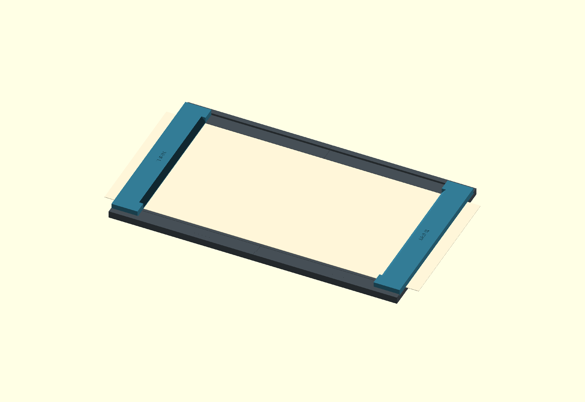
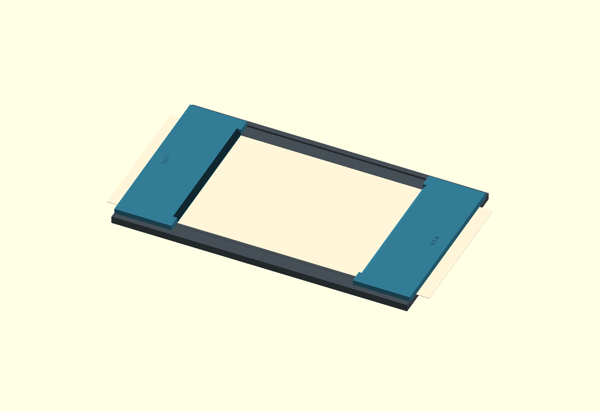
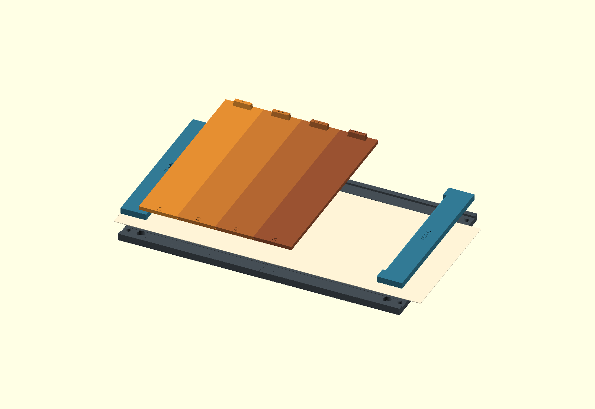
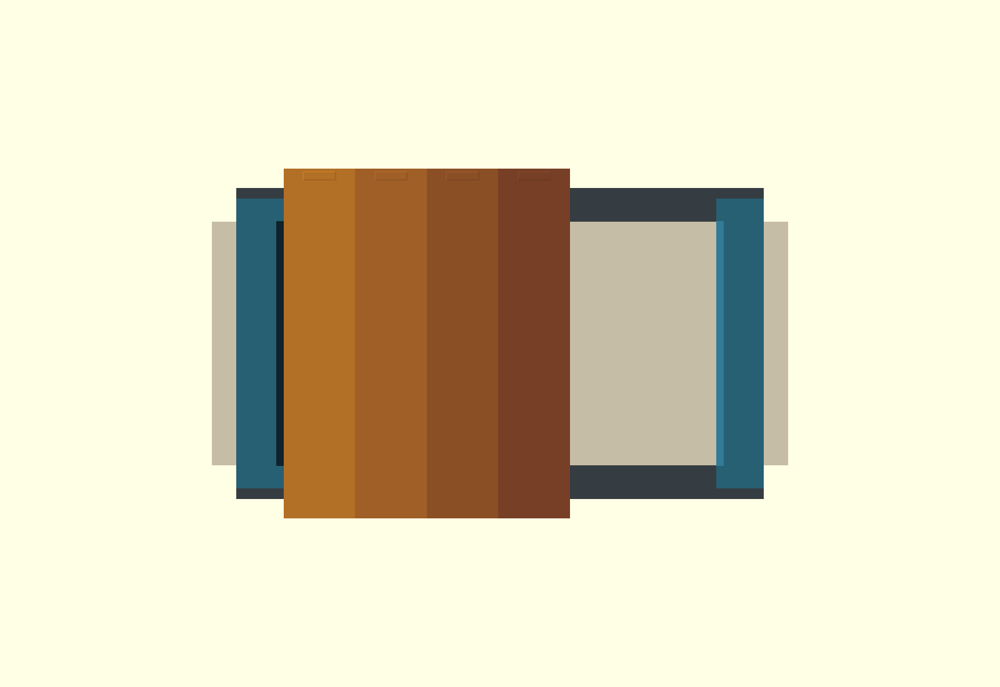
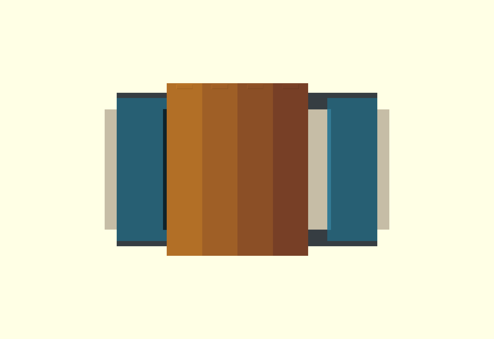

# 102 mm roll-paper enlarger holder

A flat, open-ended channel for a longer strip of 102 mm Fuji roll paper. Two removable end masks define the cut lines. Nothing overlaps the two long paper edges during a normal print, so the image can reach the full width. Four covers make test bands across the full paper width, progressing along the image length. The fifth band stays open and takes the remaining length.



The colours distinguish parts in the previews. **Print the base, masks and covers in opaque black material.** These are prototype print files; printed fit, paper flatness and light blocking still need a trial.

## Dimensions

| Feature | Nominal dimension |
| --- | --- |
| Paper width | 102 mm |
| 16:9 image / distance between cut lines | 181.333 × 102 mm |
| 4:3 image / distance between cut lines | 136 × 102 mm |
| Assembled base | 221.333 × 130.6 mm |
| Paper support height | 4 mm above the baseboard |
| Channel width | 102.6 mm, allowing 0.3 mm per side |
| Paper thickness used for the design | 0.30 mm; measure an offcut before printing |
| Channel guide height | 0.20 mm, below the paper surface |
| Mask thickness | 4.8 mm, with a bevel above the cut edge |
| First four exposure bands | Nominally 30 mm each, spanning the full 102 mm paper width |
| Always-open fifth band | 61.333 mm for 16:9; 16 mm for 4:3 |
| Cover blade / raised grip | 2.8 mm / an additional 4 mm |

The taller outside rails stand 10.3 mm away from the paper edges. There is no overhanging rail or long-side retaining lip. The masks press on the two end regions and register on pins outside the paper. Their underside magnet pockets align with pockets in the base.

Both formats use the same base and cover set. A format insert consists of **two end pieces**. The 16:9 masks cover 20 mm at each end of a base-length strip; the 4:3 masks cover 42.667 mm at each end. The open channel accepts longer strips. Keep any paper extending beyond the base outside the projected light, or cover the tails separately.



## Print list

Print each production plate once: **ten pieces on eight plates**. Every plate fits within a 174 × 174 mm area, leaving 3 mm around the A1 mini's 180 mm bed. The two halves interlock in the plane of the base. The transverse covers print flat, without diagonal placement.

| Plate source in `plates/` | Pieces | Approximate plate footprint |
| --- | --- | --- |
| `base_left.scad` | Left base with dovetail tongues | 118.7 × 130.6 mm |
| `base_right.scad` | Right base with matching sockets | 110.5 × 130.6 mm |
| `masks_16x9.scad` | Both 16:9 end masks | 46 × 121.8 mm |
| `masks_4x3.scad` | Both 4:3 end masks | 91.3 × 121.8 mm |
| `cover_1.scad` | Cover 1 | 30.8 × 146.6 mm |
| `cover_2.scad` | Cover 2 | 30.8 × 146.6 mm |
| `cover_3.scad` | Cover 3 | 30.8 × 146.6 mm |
| `cover_4.scad` | Cover 4 | 30 × 146.6 mm |
| `fit_coupon.scad` — optional, print first | Base corner, matching mask corner and cover end | 104 × 28.3 mm |

The build uses the repository's **Processor 0.20mm @BBL A1M** profile: 0.4 mm nozzle, 0.20 mm layers, four walls, six top and bottom layers, 15% infill, no supports and no brim. The filament preset is Generic PETG. Select the actual opaque black filament in Bambu Studio and reslice before printing. Keep the supplied flat orientations. The magnet-pocket roofs use short bridges; cover overlaps have 45° undersides.

Slicer estimates for the default dimensions and that profile:

| Part / plate | PETG | Print time |
| --- | --- | --- |
| Left base | 51.7 g | 1 h 39 min |
| Right base | 49.8 g | 1 h 36 min |
| 16:9 mask pair | 19.0 g | 44 min |
| 4:3 mask pair | 38.3 g | 1 h 19 min |
| Cover 1 | 14.2 g | 31 min |
| Cover 2 | 14.0 g | 31 min |
| Cover 3 | 14.0 g | 31 min |
| Cover 4 | 13.8 g | 30 min |
| **Production total** | **214.7 g** | **7 h 20 min** |
| Optional three-piece fit coupon | 7.2 g | 19 min |

Times are rounded per plate; the total uses unrounded estimates. The two masks in each pair are matching shapes and each uses about half the pair's material. Actual time and material depend on the selected filament and printer settings.

You also need **twelve 6 × 3 mm disc magnets**: four in the base and two in each of the four masks. Pockets are 6.3 mm diameter × 3.2 mm deep for a glue fit. Use a suitable adhesive; the pockets do not retain magnets by themselves. Keep adhesive and magnets recessed below the pocket openings. Check attraction with each mask in its seated orientation before gluing.

## Assemble and load

1. Print the three-piece fit coupon. Check the magnet pockets, locating pin, paper clearance and cover seat with an offcut. The mask should rest on the paper, with the locating pin entering freely. The cover should rest on the outside rail, meet the mask's square wing as an end stop, and remain above the paper.
2. Print the production parts. Remove burrs and first-layer flare, especially on the paper-contact surfaces, mask edges and dovetails. Keep the paper deck smooth and clean.
3. Join the base halves on a flat surface. The dovetails locate them horizontally; glue the joint while both undersides remain flat. Keep glue off the paper deck and check that the seam has no raised step.
4. Glue the magnets with matching polarity. Fit one complete mask pair and confirm that the bottom edges contact the paper evenly. Use either both 16:9 pieces or both 4:3 pieces, with L at the left end and R at the right. The square wings outside the paper are the cover stops; the bevel over the paper defines the cut edge.
5. Set up and focus using a scrap of the same paper on the deck. Project slightly beyond both long paper edges. The end-mask inner edges are the cut lines; there is no cutter built into the holder.
6. With the enlarger off, load the photographic paper in darkness, emulsion up. Use a strip at least as long as the base, with extra length if useful for handling. Lower the masks onto the outside locating pins. To advance the strip or change formats, lift both masks clear first.
7. After exposure and processing, trim at the two masked ends to leave the selected image ratio. Measure or mark the cut positions on the back before loading if that helps your cutting workflow.

The magnets provide end pressure; they do not pull down the middle of the paper. Check an actual roll-paper offcut for remaining curl before making a print. Flatness across the seam and through the image area must be established with the physical holder.

## Make a five-step test



Each test band runs **across the full 102 mm paper width**, so it samples the image from one long edge to the other. The four covered bands are nominally 30 mm wide along the roll. The fifth band is the remainder: **61.333 mm for 16:9** or **16 mm for 4:3**. The same four covers work with either format.

Covers 1–4 have a numeral and a matching count of recesses on the raised grip. Rest both ends on the two outside rails, with all grips on the same side. Centre each cover across the holder so both ends overhang the base by about 8 mm. Lower cover 1 against the left mask's square wings; lower each following cover against the previous one. The overlaps fit together at the same height. The covers use gravity and these end contacts, with no locating holes or stepped supports.





Start with all covers removed. For an example using a 5-second increment:

| Step | Action before exposure | Expose |
| --- | --- | --- |
| 1 | Leave all five bands open | 5 s |
| 2 | Insert cover 1 | 5 s |
| 3 | Insert cover 2 | 5 s |
| 4 | Insert cover 3 | 5 s |
| 5 | Insert cover 4; band 5 stays open | 5 s |

**Turn the enlarger off for every insertion.** The finished bands receive 5, 10, 15, 20 and 25 seconds. For an increment Δt, they receive Δt through 5Δt. The same sequence works with either mask pair.

The 0.8 mm overlapping tongues reduce direct gaps between covers. Covers 1–3 extend that far into the following band; judge exposure at least 1 mm away from each seam. Cover 4 has no forward tongue, so it preserves the remaining fifth band. The blades sit nominally 1.3 mm above 0.30 mm paper; actual boundary softness also depends on the enlarger, seating and any blade sag. Remove the covers in reverse order, 4 through 1, to release the overlaps.

Before relying on the test result, expose a covered scrap for the longest intended test time and process it alongside an unexposed scrap. Check for transmission through the plastic or seams. Material colour and mesh checks alone do not establish opacity.

## Sources and exports

Open [model.scad](model.scad) to inspect the assembly. `format` selects `16:9` or `4:3`, `cover_count` selects 0–4 covers, and `exploded` lifts the removable pieces for inspection. Export the individual files in `plates/` for printing; the assembly includes reference paper and is not a print plate.

Edit [parameters.scad](parameters.scad) for measured paper width/thickness and fit clearances. The default 102 mm width follows the requested measurement. If the roll measures differently, update it and rebuild every part; aperture lengths follow the measured width. `band_width` independently sets the four fixed bands, default 30 mm. Assertions require at least 8 mm left for the fifth band in 4:3 and reject unsupported combinations. Plate wrappers must all use the same settings.

From the repository root, after installing the dependencies described in the main README:

```sh
# Check actual meshes and fit/exposure probes; no slicer required.
.venv/bin/python scripts/check_enlarger.py

# Check geometry, render assemblies, slice every plate with the existing
# A1 mini profile, export Bambu projects, and package the complete set.
.venv/bin/python scripts/build_enlarger.py

# Geometry and assembly renders only.
.venv/bin/python scripts/build_enlarger.py --geometry-only
```

The full build writes `build/enlarger/fuji-102-enlarger-holder.zip`, containing STLs, Bambu A1 mini `.3mf` projects, plate previews, editable OpenSCAD sources, these instructions and validation summaries. Individual projects are under `build/enlarger/plates/<name>/`. The projects contain models and settings for reslicing; the build does not send anything to a printer. Use the same tool and preset environment overrides as `scripts/build_openscad.py`.

The geometry checks cover nine print plates and 79 fit, exposure and invalid-setting cases. They check connected closed meshes, printer bounds, the base joint, paper feed clearance, magnets, mask/cover collisions, both image lengths, all five exposed areas and rays tilted 30° toward either long edge. Thicker paper and a 100 mm roll are included. Bambu slicing checks printability separately. Actual paper retention, opacity, print tolerances and print quality remain physical checks.
